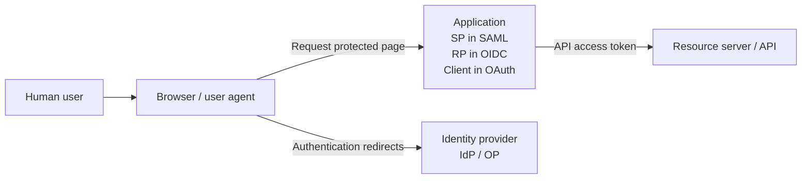

# 01 — Terminology and Mental Models

> **Read first.** Most SAML/OIDC confusion comes from the same entity having different names in different specifications.

## 1. The two fundamental questions

**Authentication (AuthN)** asks: *Who or what is making this request?* Authentication can use a password, CAC/PIV, passkey, MFA, certificate, or a platform-issued workload assertion.

**Authorization (AuthZ)** asks: *Is that authenticated principal allowed to do this particular action on this resource?* A successful login alone never grants every action.

**Federation** is a trust arrangement under which one system accepts identity information or assertions from another issuer rather than maintaining a separate password for that user. **Single sign-on (SSO)** is the user experience of reusing an identity session across applications; federation often enables SSO but they are not identical.

## 2. Glossary — learn these before the protocols

| Term | Plain-English explanation | Example |
|---|---|---|
| **Principal / subject** | Entity being identified; can be a person or workload | Employee or GitHub job |
| **IdP** | Identity Provider: authenticates users and issues identity statements | Entra ID, ADFS, Okta |
| **SP** | SAML Service Provider: application that consumes SAML responses | SAML-enabled SaaS app |
| **OP** | OpenID Provider: OIDC-capable identity issuer | Entra ID OIDC endpoint |
| **RP** | OIDC Relying Party: app consuming the OIDC authentication result | Web app or ALB |
| **OAuth client** | Software requesting authorization / tokens; can be server, SPA, CLI, daemon | Web application |
| **Resource owner** | Entity able to grant or control resource access, often a user | Employee granting calendar access |
| **Authorization server (AS)** | Issues OAuth tokens after authorization/authentication and policy checks | Entra token service |
| **Resource server (RS)** | API receiving and enforcing access tokens | Microsoft Graph or your REST API |
| **User agent** | Browser or agent carrying redirects between app and IdP | Chrome |
| **Claim / attribute** | A named statement about a subject or context | `sub`, `email`, department |
| **Issuer (`iss`)** | Who issued and signed a token | `https://login.microsoftonline.com/...` |
| **Subject (`sub`)** | Which identity the token describes, under the issuer's namespace | Stable app-specific user ID |
| **Audience (`aud`)** | Which consumer(s) may accept the assertion or token | Client ID, API ID, or STS audience |
| **Scope** | Requested/granted range of access or identity information | `openid`, `profile`, `api.read` |
| **Bearer credential** | Possession permits presentation; stolen usable token may be replayed | OAuth bearer access token |
| **Opaque token** | Token whose internal format/meaning is not defined for its holder | Random-looking access token |
| **JWT** | JSON Web Token, compact container for claims; not itself a protocol | Signed OIDC ID token |
| **JWKS** | JSON Web Key Set containing public keys for JWT signature verification | GitHub signing keys |
| **STS** | AWS Security Token Service: issues AWS temporary credentials | `AssumeRoleWithWebIdentity` |
| **Front channel** | Messages transported via user's browser | SAML POST; OAuth authorization redirect |
| **Back channel** | Direct service-to-service HTTPS exchange | Authorization code redemption |
| **Session cookie** | App-managed browser login continuity, distinct from an ID token | ALB auth session cookie |
| **Trust policy** | Defines who can assume an AWS IAM role and under what conditions | GitHub repo and branch restricted |
| **Permissions policy** | Defines what actions an assumed AWS role can perform | `s3:GetObject` |

## 3. The most confusing word: *client*

In everyday HTTP, the **browser** is called a client. In **OAuth/OIDC**, the *client* is the registered application requesting tokens. For a server-side website, the **server application** is the OAuth client even though the browser initiates HTTP requests. A browser-based SPA can itself implement the OAuth client role.

| Neutral element | SAML name | OIDC name | OAuth name |
|---|---|---|---|
| Authentication issuer | IdP | OP | Authorization server (if also handles identity) |
| Application receiving login | SP | RP | Client |
| Browser | User agent | User agent | User agent |
| API receiving access token | No native analogous role | OAuth resource server | Resource server |



These are **role analogies**, not a claim that every protocol has identical semantics. An app may be an API/resource server for incoming requests *and* an OAuth client when calling another API.

## 4. Tokens are not interchangeable

| Artifact | Intended use | Consumer |
|---|---|---|
| SAML assertion | Attest user's authentication/attributes | SP |
| OIDC ID token | Tell the OIDC client who authenticated | RP/client |
| OAuth access token | Permit access to API/resource | Resource server |
| OAuth refresh token | Renew authorization through token endpoint | Authorization server, via client |
| Authorization code | One-time intermediate value redeemed for tokens | Authorization server / token endpoint |
| GitHub Actions OIDC JWT | Attest workflow identity for workload federation | AWS STS or another configured audience |
| STS credentials | Sign AWS API calls (SigV4) | AWS services |

**Bearer ≠ JWT:** bearer describes how possession confers authority; JWT describes a format. An access token may be an opaque string or a JWT. The client should not assume it can interpret an access token issued for someone else's API.

## 5. Three claims with one consistent example

```json
{
  "iss": "https://login.example.test/tenant",
  "sub": "user-12345",
  "aud": "web-app-client-id",
  "exp": 1794000000
}
```

- **`iss`** is *who vouches for the identity*. It must match your configured trusted issuer.
- **`sub`** is *who is being identified*. It is often **not** an email and can differ between applications.
- **`aud`** is *who is permitted to consume this token*. For an OIDC ID token, usually the RP/client ID. For an API access token, the API. Some tokens support **multiple audiences**, which must be evaluated under applicable profile rules.

## 6. Five-question self-check

1. A browser opens `app.example.com`; which component is the OIDC client? **The registered app (possibly an ALB), not automatically the browser.**
2. Who verifies an API access token? **The API/resource server (or its gateway).**
3. Does a valid JWT signature prove that this token is for your app? **No, check `aud`, `iss`, time and flow conditions.**
4. What does possession of a bearer token mean? **A holder may be able to use it until expiration/revocation/other constraints.**
5. Does a `sub` always contain a human? **No: workload tokens can identify jobs or service accounts.**

**Next:** [02 — SAML 2.0 Fundamentals](02_SAML_2_0_Fundamentals.md).
