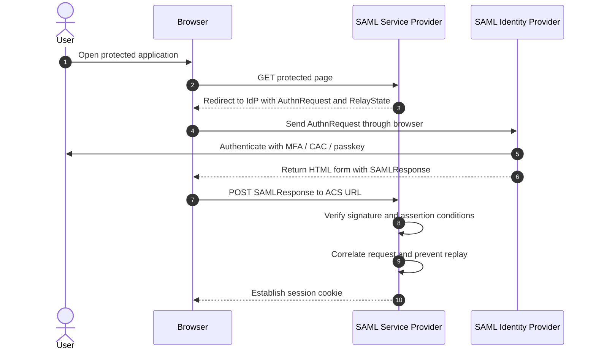
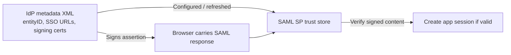

# 02 — SAML 2.0 Fundamentals

## 1. The problem SAML solves

A company wants a single IdP (for example, Entra ID or ADFS) to authenticate employees for many web applications. Each application acts as a **Service Provider (SP)** and relies on the IdP's signed identity assertion. SAML primarily standardizes **federated authentication for web SSO**; it does not define OAuth-style API scopes or access tokens.

## 2. SAML terms

| Item | What it does |
|---|---|
| `entityID` | Identifier for IdP or SP |
| `AuthnRequest` | SP asks IdP to authenticate the user |
| SAML Response | XML envelope, usually carrying an assertion |
| SAML Assertion | Signed (depending on deployment) statement about subject and conditions |
| `NameID` | Identity identifier used by SP (not always email) |
| `AttributeStatement` | Attributes, e.g., department and groups |
| `AudienceRestriction` | Limits intended SP consumer |
| `Recipient`, `Destination` | Bind delivery to expected endpoint |
| `NotBefore`, `NotOnOrAfter` | Time validity window |
| `InResponseTo` | Binds response/assertion to initiating request |
| `RelayState` | Preserves application context; validate before redirecting |
| **ACS URL** | Assertion Consumer Service where browser posts response |
| **Metadata** | XML publishing entity IDs, bindings, endpoints and signing keys/certs |

## 3. SP-initiated login (HTTP-Redirect request, HTTP-POST response)



**Key idea:** in the common HTTP-POST binding, the **browser carries the SAML response**. The SP typically validates the signed content locally using trusted IdP signing key material; the SP does not need a per-login token introspection request.

## 4. Example assertion (simplified; deliberately not a full valid signed response)

```xml
<saml:Assertion xmlns:saml="urn:oasis:names:tc:SAML:2.0:assertion">
  <saml:Issuer>https://idp.example.test</saml:Issuer>
  <saml:Subject>
    <saml:NameID>employee123</saml:NameID>
  </saml:Subject>
  <saml:Conditions NotBefore="2026-11-07T12:00:00Z"
                   NotOnOrAfter="2026-11-07T12:05:00Z">
    <saml:AudienceRestriction>
      <saml:Audience>https://app.example.test/saml</saml:Audience>
    </saml:AudienceRestriction>
  </saml:Conditions>
  <saml:AttributeStatement>
    <saml:Attribute Name="department">
      <saml:AttributeValue>Engineering</saml:AttributeValue>
    </saml:Attribute>
  </saml:AttributeStatement>
</saml:Assertion>
```

Real deployments include a Response wrapper, signatures on the Response and/or Assertion as configured, subject confirmation, recipient, status, and other protocol fields. Do **not** use the snippet as a valid production fixture.

## 5. What must the SP validate?

1. The signature covering **the exact XML Response/assertion it will consume**, against a configured trusted IdP key.
2. Expected IdP **Issuer** and SP **AudienceRestriction**.
3. Required **Destination**, **Recipient**, and subject-confirmation fields.
4. Assertion and subject-confirmation validity times, allowing only controlled clock skew.
5. `InResponseTo` against the outstanding AuthnRequest when using SP-initiated SSO.
6. Assertion/response IDs against replay, and proper handling of errors/status.
7. Identity and group attribute semantics before provisioning or granting access.

**XML signature wrapping** occurs when an app validates one signed node but processes a different malicious node. Use a maintained, security-reviewed SAML implementation; never build your own XML signature parser.

## 6. SAML metadata and certificate rollover

Metadata may describe SP/IdP entity IDs, SSO/ACS endpoints, supported bindings, and signing certificates. Some integrations manually upload XML; others refresh metadata from a URL. **SAML is not universally manual**, nor is OIDC configuration fully automatic: both require trust and app registration.



Plan overlap during signing certificate rotation; verify which certificate is currently trusted and whether the app caches metadata.

## 7. SP-initiated vs IdP-initiated

**SP-initiated** begins at the application and supports request correlation through `InResponseTo`. **IdP-initiated** starts at the IdP portal and sends an unsolicited response; some SPs support it, but it has weaker request-correlation characteristics and needs careful replay, recipient, and login-CSRF defenses.

**Less common:** HTTP-Artifact binding sends the browser a short reference that the SP resolves with the IdP over a back channel; not every IdP/SP supports it.

## 8. SAML and API access

The SP commonly creates its own **application session cookie** after accepting an assertion. That does not by itself produce an OAuth access token for a backend API; API authentication/authorization must be designed separately.

**Next:** [03 — OAuth and OIDC](03_OAuth_2_0_and_OIDC.md).
