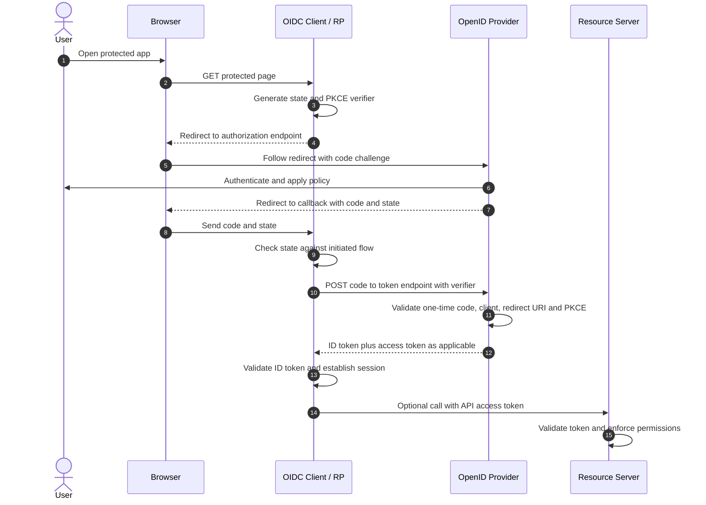

# 03 — OAuth 2.0 and OpenID Connect

## 1. Why there are two standards

**OAuth 2.0** is an authorization framework: it allows a **client** to obtain access to a **resource server (API)** under specified permissions, without using the resource owner's password as the API credential. It is not a generic login protocol.

**OIDC** adds a standardized authentication layer on OAuth: when the client requests the `openid` scope in an appropriate OIDC flow, the provider returns an **ID token** addressed to that client, with defined identity and authentication semantics.

| Question | Mechanism | Main output |
|---|---|---|
| Who authenticated to this app? | OIDC | ID token |
| What may this client do at this API? | OAuth 2.0 | Access token |
| How does this browser stay logged into a site? | Application/ALB session management | Session cookie |

## 2. Standard endpoints — who calls what?

| Endpoint | Usually called by | Request | Output |
|---|---|---|---|
| `/.well-known/openid-configuration` | OIDC client/configuration code | HTTPS GET | Issuer, endpoint URLs, capabilities, `jwks_uri` |
| `authorization_endpoint` (`/authorize`) | Browser following a client redirect | `client_id`, `response_type=code`, `redirect_uri`, `scope`, `state`; often PKCE/nonce | Login/consent then **authorization code** via redirect |
| `token_endpoint` (`/token`) | Client (back channel) | Code, redirect URI, client auth as applicable, PKCE verifier | ID token when OIDC, access token, optional refresh token |
| `jwks_uri` | Token verifier | HTTPS GET | Public signing keys in JWK Set |
| `userinfo_endpoint` | Client with appropriate access token | `Authorization: Bearer ...` | User claims JSON, subject consistent with ID token |
| `introspection_endpoint` (optional OAuth) | Authorized resource server | Token | Token metadata/active status |
| `revocation_endpoint` (optional OAuth) | Client | Token to revoke | Revocation response |

**Important:** endpoint URLs vary by provider. The JWKS URL is **not always** `/.well-known/jwks.json`; read `jwks_uri` from discovery. An app registration still must supply correct issuer, client ID, redirect URI, and (for confidential clients) authentication material.

## 3. Authorization Code Flow: exact role of the code



**Does the app verify the authorization code?** Not by locally checking a JWT signature. It checks **state** and correlation; the authorization server validates the **code** when it is redeemed at the token endpoint. The client then validates the returned ID token according to the OIDC flow/profile.

A code is short-lived, single-use, and bound to the client and redirect URI; PKCE additionally binds redemption to the request initiator. The code is not itself the user's authenticated session or an API access token.

## 4. Example token endpoint exchange (illustrative)

```http
POST /oauth2/v2.0/token HTTP/1.1
Host: login.microsoftonline.com
Content-Type: application/x-www-form-urlencoded

grant_type=authorization_code&client_id=web-client-id&code=one-time-code&redirect_uri=https%3A%2F%2Fapp.example.test%2Fcallback&code_verifier=example-verifier
```

A confidential client additionally authenticates with a supported method (for example, client secret or signed client assertion); a public client must not embed a reusable secret. In production, a robust library handles request formatting and validation.

## 5. ID token vs access token vs refresh token

| | ID token | Access token | Refresh token |
|---|---|---|---|
| Purpose | Authentication result for RP | API authorization | Renew tokens |
| Audience | OIDC client (`client_id`) | API / resource server | Authorization server, not API |
| Format | Signed JWT in common OIDC flows | JWT, opaque, or another agreed format | Typically opaque to client |
| Who validates/consumes it? | RP/client | API/resource server | Authorization server on refresh |
| Send to backend APIs? | **No** | **Yes, if issued for that API** | **No** |

Do not treat `openid`, `profile`, and `email` as API permissions: they are OIDC scopes requesting authentication and identity information. A custom API scope (such as `api.read`) has separate meaning.

## 6. `state`, `nonce`, PKCE — three different problems

| Control | Generated by | Checked by | Security function |
|---|---|---|---|
| `state` | Client | Client on callback | Correlates redirect; mitigates login CSRF |
| `nonce` | Client (when used) | Client against ID token | Binds ID token to authentication request; resists replay/injection |
| PKCE verifier/challenge | Client | Authorization server during code redemption | Binds authorization code to initiating client instance |

**PKCE is not client authentication.** Confidential clients still authenticate to the token endpoint as required. Prefer Authorization Code with PKCE for new user-facing integrations; public clients require PKCE under modern security guidance.

## 7. Confidential and public clients

- **Confidential client:** server-side component that can protect a credential (e.g., backend web app, ALB). Supports client secret, private key assertion, or other provider-supported method.
- **Public client:** SPA, mobile application, desktop CLI; cannot safely keep a shared secret. Use PKCE and registered redirect URIs.

## 8. Other OAuth grants and their proper scope

| Mechanism | Human login? | Returns OIDC ID token? | Used for |
|---|---|---|---|
| Authorization Code + PKCE | Usually yes | When `openid` and OIDC provider | Interactive web/mobile/SPA login |
| Client Credentials | No | Normally no; **OAuth, not OIDC login** | Workload calling API as itself |
| Device Authorization | User approves on second device | If OIDC scope/profile | CLI/headless device |
| Refresh Token | No new login necessarily | Provider/profile dependent | Renewal |
| Token Exchange / On-Behalf-Of | Context dependent | Profile dependent | Middle-tier delegated API calls |
| Implicit | Yes | Can | Legacy; avoid new designs |
| Resource Owner Password | Yes, password sent to client | Depends | **Do not use for new designs** |

**Next:** [04 — JWT, JWKS and Validation](04_JWT_JWKS_and_Token_Validation.md).
