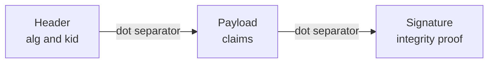
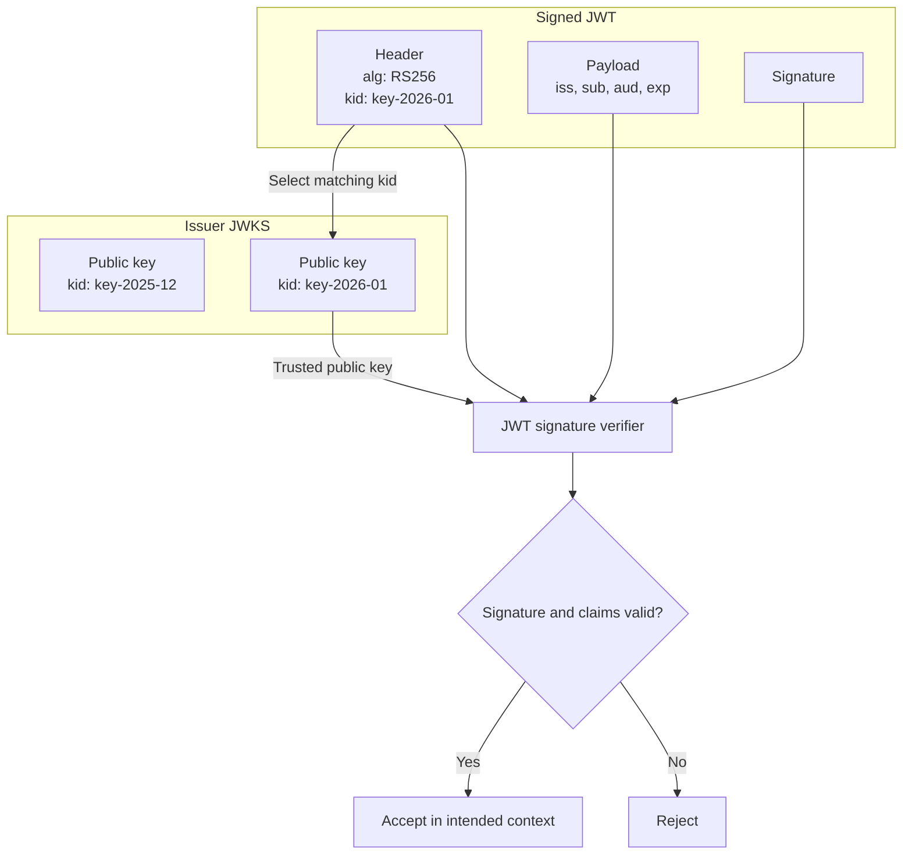
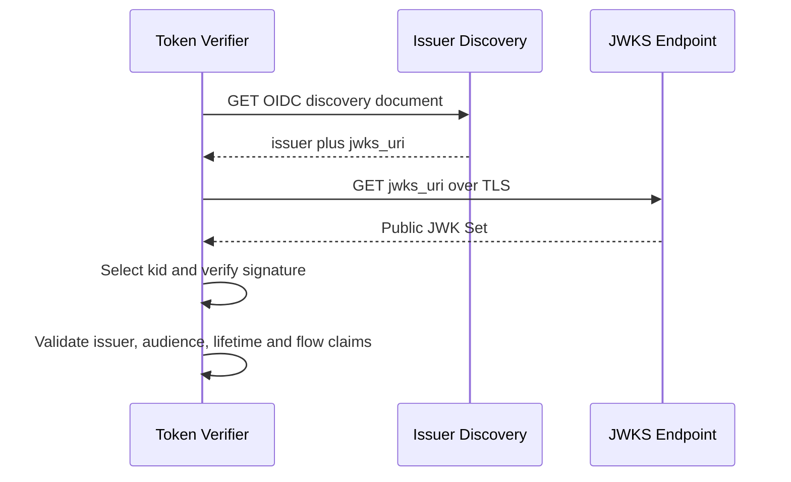

# 04 — JWT, JWKS and Token Validation

## 1. JWT is a format, not a guarantee of trust

A signed JWT (JWS compact serialization) has three Base64URL-encoded parts joined by periods:

```text
base64url(header).base64url(payload).base64url(signature)
```

The first two sections are **encoded, not encrypted**. Anyone who possesses a normal JWT can decode its header and claims. A valid signature detects changes; it does not conceal sensitive data. Do not log tokens.



Example JWT header:

```json
{ "alg": "RS256", "typ": "JWT", "kid": "key-2026-01" }
```

Example ID-token payload (illustrative):

```json
{
  "iss": "https://login.example.test/tenant",
  "sub": "user-12345",
  "aud": "web-client-id",
  "iat": 1794000000,
  "exp": 1794003600,
  "nonce": "request-bound-random-value"
}
```

## 2. Signature vs encryption vs bearer

- **Signature:** proves integrity and, if the key is trusted, that the designated signer signed the token.
- **Encryption:** conceals token contents from unauthorized readers. JWE is an optional JSON Web Encryption format.
- **Bearer:** whoever possesses a bearer credential can present it; sender-constrained alternatives such as DPoP or certificate-bound tokens reduce replay risk.
- **Opaque:** the holder has no right to infer token meaning from representation; this is distinct from whether a token is a JWT.

The expression **“encrypted hash”** is an oversimplification of modern digital signatures. With RS256 the signer signs a hash using an RSA signature scheme, and a verifier uses the corresponding public key and algorithm to verify the signature. Do not implement cryptography manually.

## 3. JWKS: public keys, not secrets

The OpenID Provider signs tokens with its **private key**, while exposing corresponding **public keys** through a JWKS URI. The header's `kid` identifies the key to select. A JWK can include `kty`, `kid`, `use`, `alg`, and RSA modulus/exponent (`n`, `e`). The keys are public; never put private signing keys in JWKS.



## 4. Discovery: find keys and endpoints

OIDC metadata commonly lives at an issuer-specific URL containing `/.well-known/openid-configuration`. It returns `issuer`, `authorization_endpoint`, `token_endpoint`, `userinfo_endpoint` when supported, and **`jwks_uri`**. Always use the provider's published metadata and check the returned issuer against the configured trusted issuer; **do not guess a generic JWKS path**.



Keys may be cached, and key rotation means multiple active public keys can appear simultaneously. Refresh on unknown `kid` according to a safe caching strategy, rate limits and trusted discovery URL handling. A JWKS URL is not an arbitrary token-provided URL that the verifier should fetch.

## 5. Check these BEFORE trusting ID-token claims

1. Verify token **type/profile** and an explicitly permitted signing **algorithm**; reject `alg=none` unless a narrowly specified protocol case explicitly allows it.
2. Verify the signature with a public key selected from the **configured issuer's trusted JWKS**, not from untrusted token-controlled URLs.
3. Validate `iss` = expected issuer, not merely a well-formed HTTPS hostname.
4. Validate `aud` includes the registered client ID; apply `azp` rules when the token/profile requires it.
5. Validate `exp`, `iat` and other relevant times with controlled clock skew; validate `nbf` if present.
6. Validate `nonce` when required/used, and flow-specific request binding (`state`, PKCE).
7. Ensure expected subject and policy-sensitive attributes are present and correctly interpreted.
8. Preserve issuer+subject namespaces: do not equate `email` with a stable user identifier.

A verifier should use a well-maintained OIDC/JWT library. **Signature verification alone is necessary but not sufficient** for trust.

## 6. Who validates what?

| Scenario | Validator | Main evidence |
|---|---|---|
| SAML Web SSO | SP | XML signature, issuer, audience, destination, times, response correlation |
| OIDC user login | RP/client | ID token and protocol request context |
| OAuth API call | Resource server / API gateway | Access-token audience, lifetime, scopes/roles, signature or introspection |
| GitHub OIDC to AWS | AWS STS | GitHub JWT issuer/signature/time/audience and IAM trust conditions |
| ALB forwards identity headers | Backend app | ALB-signed `x-amzn-oidc-data` and expected ALB signer |

## 7. Where failures occur

| Failure | Likely category |
|---|---|
| Signature invalid | Wrong issuer/JWKS key, rotation, altered token, algorithm mismatch |
| Audience mismatch | Token issued to different client/API/STS audience |
| Issuer mismatch | Wrong tenant or identity provider |
| Token expired | Clock skew or expired token |
| `state` mismatch | Wrong browser flow / cookie / redirect / CSRF protection |
| PKCE mismatch | Wrong verifier or code interception/injection |
| Role trust denies | IAM `sub`/`aud` restrictions or principal/action mismatch |

**Next:** [05 — AWS, Entra and GitHub Flows](05_AWS_Entra_and_GitHub_Flows.md).
