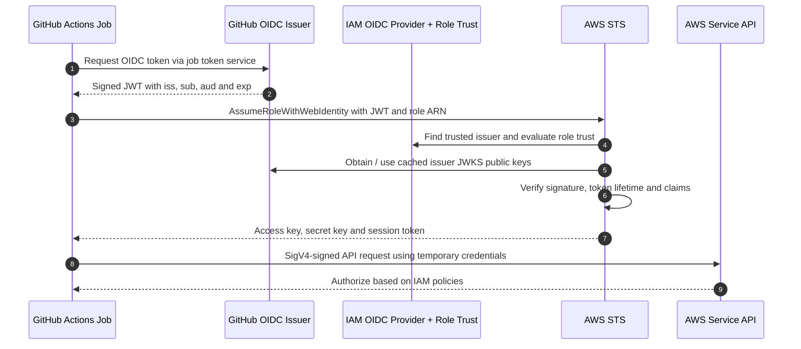

# 05 — Practical Flows: Entra + ALB and GitHub Actions + AWS STS

> These patterns both use OIDC-related concepts but **solve different problems**: browser **user authentication** versus **workload credential federation**.

## 1. Entra ID to AWS ALB — browser authentication

**Actors:** user/browser; ALB as OIDC client/RP; Entra ID as OP; backend application as ALB target. ALB `authenticate-oidc` is an **HTTPS listener-rule action**, not ALB listener mTLS. An ALB application rule can require OIDC authentication for matching requests.

### Sequence diagram

```mermaid
sequenceDiagram
    autonumber
    actor User
    participant Browser
    participant ALB as AWS Application Load Balancer
    participant Entra as Microsoft Entra ID
    participant App as Backend Application
    User->>Browser: Open protected web app
    Browser->>ALB: GET /protected
    ALB->>ALB: Check ALB auth session cookie
    ALB-->>Browser: Redirect to Entra authorization endpoint
    Browser->>Entra: GET authorize endpoint
    Entra->>User: Authenticate user; apply MFA / Conditional Access
    Entra-->>Browser: Redirect with authorization code and state
    Browser->>ALB: GET /oauth2/idpresponse with code and state
    ALB->>ALB: Validate flow correlation / state
    ALB->>Entra: POST token endpoint with authorization code and client credentials
    Entra->>Entra: Validate code, client and redirect URI
    Entra-->>ALB: ID token and access token
    ALB->>Entra: GET UserInfo with access token
    Entra-->>ALB: User claims
    ALB-->>Browser: Set ALB authentication session cookie
    Browser->>ALB: Request with session cookie
    ALB->>App: Forward request with x-amzn-oidc headers
    App-->>ALB: HTTP response
    ALB-->>Browser: Protected content
```

### Which endpoint returns what?

| Endpoint | Called by | Returns / does |
|---|---|---|
| Discovery | Configuration tooling / OIDC software | Expected issuer and endpoint URLs, JWKS URI |
| Authorization | User's browser | Authentication and a redirect carrying one-time code |
| Token | ALB → Entra HTTPS | ID token + access token for successful code exchange |
| UserInfo | ALB → Entra HTTPS | Claims for the authenticated subject |
| JWKS | JWT-verifying clients | Public signing keys (not private secrets) |
| ALB callback `/oauth2/idpresponse` | Browser → ALB | Delivers `code` and `state` to ALB; not an Entra endpoint |

**Crucial ALB-specific nuance:** AWS documentation explicitly states that the ALB requests **UserInfo** with the access token, creates its own authenticated session, and sends `x-amzn-oidc-*` headers to the target. **It does not forward Entra's original ID token to the backend.** The `x-amzn-oidc-data` header is an **ALB-signed JWT** containing claims returned by UserInfo, not the original Entra ID token.

### Backend trust boundary

- `x-amzn-oidc-data`: ALB-signed claims JWT. Verify its **signature**, expiration and the expected **`signer` ALB ARN** before relying on its content.
- `x-amzn-oidc-identity`: unsigned subject header; do not trust in isolation.
- `x-amzn-oidc-accesstoken`: unsigned forwarded access-token header; treat as sensitive and do not trust it as a substitute for the signed identity header.
- Restrict backend network access so callers cannot bypass the ALB and spoof headers.
- For GovCloud, AWS documents separate regional S3 endpoints for fetching **ALB signing verification keys**. These are different from Entra's JWKS keys.

**Do not assume** the backend can independently reconstruct exactly how ALB validated the upstream Entra ID token; AWS documents the service-managed authentication flow. The backend's explicit verification responsibility is the **ALB-generated signed claims header**.

**References:** [AWS ALB auth flow and claims headers](https://docs.aws.amazon.com/elasticloadbalancing/latest/application/listener-authenticate-users.html).

## 2. GitHub Actions → AWS STS — workload identity federation

**Actors:** GitHub workflow/job; GitHub OIDC token issuer; AWS IAM OIDC provider configuration; IAM role trust policy; AWS STS; AWS services. No human browser callback or authorization code exchange is needed.



### The three trust components

1. **IAM OIDC provider registration** records which GitHub issuer is trusted and its permitted audiences, e.g. `https://token.actions.githubusercontent.com` and commonly `sts.amazonaws.com`.
2. **IAM role trust policy** restricts who may call `sts:AssumeRoleWithWebIdentity`, ideally matching an exact GitHub `sub` identifying the repository and protected branch/environment.
3. **Role permissions policy** limits actions after STS creates the role session. Trust is not permission to access all AWS services.

### How the workflow requests the GitHub token

```yaml
name: AWS deployment
on:
  push:
    branches: [main]
permissions:
  id-token: write
  contents: read
jobs:
  deploy:
    runs-on: ubuntu-latest
    steps:
      - uses: actions/checkout@v4
      - uses: aws-actions/configure-aws-credentials@v4
        with:
          role-to-assume: arn:aws-us-gov:iam::111122223333:role/github-deploy
          aws-region: us-gov-west-1
      - run: aws sts get-caller-identity
```

For a commercial AWS account, the role ARN partition is `arn:aws:iam::...`; GovCloud IAM role ARNs use `arn:aws-us-gov:iam::...`. Check the appropriate STS endpoint/partition for your deployment. Actions version numbers should be reviewed and pinned to approved versions or commit SHAs in production.

### GitHub JWT claims (illustrative)

```json
{
  "iss": "https://token.actions.githubusercontent.com",
  "sub": "repo:my-org/my-repo:ref:refs/heads/main",
  "aud": "sts.amazonaws.com",
  "repository": "my-org/my-repo",
  "ref": "refs/heads/main",
  "run_id": "123456789",
  "exp": 1794000600
}
```

The job identity `sub` is **not a human user ID**. If the job uses a GitHub **environment**, its default `sub` can be `repo:my-org/my-repo:environment:prod` instead of a branch subject. Protect environments with approved deployment branches and reviewers.

### Minimal IAM role trust policy (GovCloud example)

```json
{
  "Version": "2012-10-17",
  "Statement": [{
    "Effect": "Allow",
    "Principal": {
      "Federated": "arn:aws-us-gov:iam::111122223333:oidc-provider/token.actions.githubusercontent.com"
    },
    "Action": "sts:AssumeRoleWithWebIdentity",
    "Condition": {
      "StringEquals": {
        "token.actions.githubusercontent.com:aud": "sts.amazonaws.com",
        "token.actions.githubusercontent.com:sub": "repo:my-org/my-repo:ref:refs/heads/main"
      }
    }
  ]
}
```

The configured `aud` must match the audience requested in the GitHub job and accepted by AWS IAM. Confirm the audience for your specific AWS partition/provider/action configuration; do not assume that the STS endpoint hostname and OIDC audience string must be identical.

### How STS verifies the JWT

- Locate the IAM OIDC provider associated with the token's **issuer** and role's federated principal.
- Validate signature using **GitHub's trusted public keys** obtained from OIDC metadata/JWKS (possibly cached).
- Validate token time and configured audience.
- Evaluate **role trust policy** including GitHub subject restrictions.
- Return **AWS temporary credentials**, not an Entra-style web login session or access token.
- AWS API requests are subsequently signed with SigV4 and evaluated against role/session policies and applicable organizational/resource controls.

**Two distinct authorizations:** (1) may the workflow **assume the IAM role?** (2) may the resulting role session **perform the requested AWS API operation?**

## 3. Comparing the patterns

| | Entra + ALB | GitHub Actions + AWS STS |
|---|---|---|
| Subject | Human | CI workflow job |
| Browser login | Yes | No |
| Authorization code | Yes | No |
| Main consumer | ALB as OIDC RP | STS as web identity credential exchanger |
| Identity artifact | Entra ID token + UserInfo claims | GitHub-issued signed JWT |
| Result | ALB session cookie and forwarded identity headers | STS role credentials |
| Subsequent authorization | Application policy / backend controls | IAM policy evaluation on AWS requests |

**Next:** [06 — Architecture Decisions](06_Architecture_Decisions_and_Advanced_Concepts.md).
