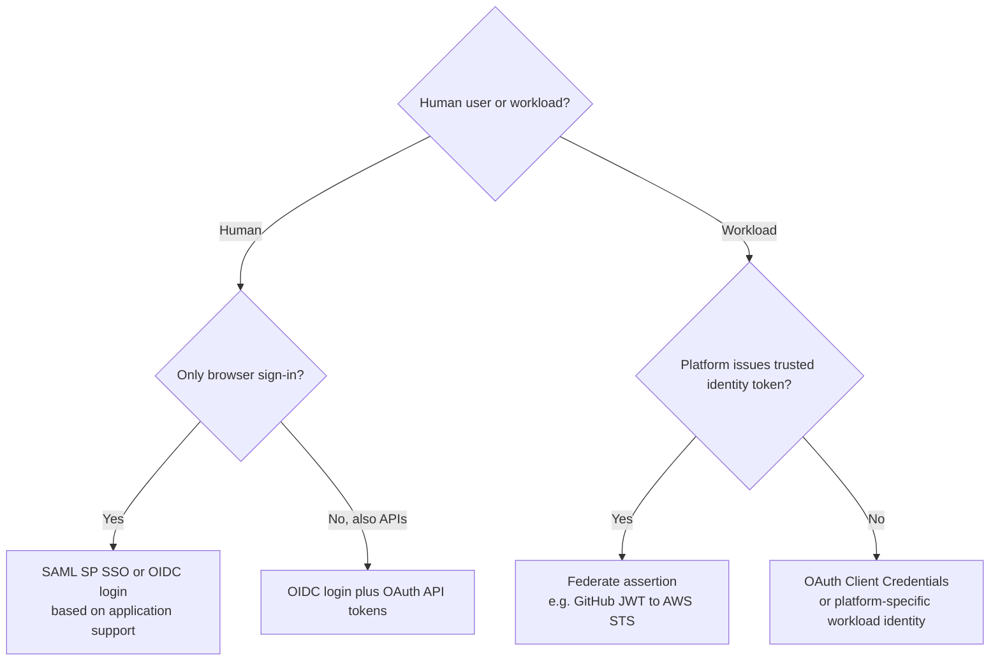
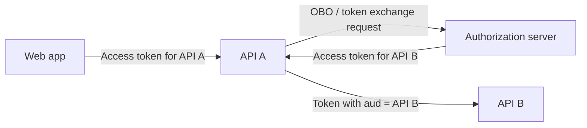

# 06 — Architecture Decisions, Threats and Advanced Concepts

## 1. Choosing SAML, OIDC, OAuth or workload federation

| Requirement | Best starting point | Why |
|---|---|---|
| Existing enterprise SaaS/browser SSO only supports SAML | SAML 2.0 | Native SP/IdP federation |
| Modern web application requires interactive login | OIDC Authorization Code + PKCE | Standard ID token and secure code exchange |
| SPA/mobile app requires sign-in | OIDC Authorization Code + PKCE | Public clients cannot safely keep client secrets |
| Web app calls user-delegated backend APIs | OIDC login + OAuth access tokens | Separate audience and permission per API |
| Daemon calls API without a human | OAuth Client Credentials | Application permissions; no human ID token |
| GitHub/GitLab job deploys to AWS | OIDC JWT federation → STS | No stored AWS IAM user access keys |
| Existing SAML IdP authenticates AWS console users | SAML federation or IAM Identity Center | AWS console federation support |
| Application uses ALB as front-door authentication | ALB `authenticate-oidc` | ALB manages login/session and forwards verified claims |

Do not choose solely by XML vs JSON: the actual deciding factors are **supported consumer, token audience, application architecture, API delegation, session behavior and operational constraints**.

## 2. The Four-Question architecture model

1. **Subject:** human or workload?
2. **Consumer:** application session, protected API, or token/credential broker?
3. **Channel:** browser front channel, back channel, or direct workload assertion?
4. **Client security:** can the application keep a credential, and what replay defenses apply?

## 3. Threat model — controls that solve different problems

| Threat / error | SAML protection | OAuth/OIDC protection | AWS workload-specific protection |
|---|---|---|---|
| Forged issuer statement | Verify XML signatures | Verify JWT signature / introspection | STS verifies trusted GitHub issuer keys |
| Wrong relying party | `AudienceRestriction` | `aud` + relevant `azp` rules | Trusted provider audience and role `sub` |
| Replay | Assertion IDs and replay cache | Short token lifetimes, nonce where required; sender constraints | Short JWT lifetime and short STS sessions |
| Browser/login CSRF | Request correlation where SP-initiated | `state` with browser binding; PKCE | Not an interactive browser flow |
| Stolen code | Less relevant to POST flow | PKCE and one-time token redemption | No authorization code |
| Wrong identity mapping | NameID/attributes policy | Issuer-qualified `sub`, stable identifiers | Match exact repo/ref/environment subject |
| Privilege excess | SP application roles | API scopes and resource policy | IAM role permissions, boundaries, SCPs as applicable |
| Signing-key rotation | Trusted metadata rollover | JWKS refresh and key selection | GitHub JWKS retrieval/cache via STS |
| Backend trusts unverified identity header | SP/session validation | Verify signed ALB `x-amzn-oidc-data` | Prevent bypass of front-door trust boundary |

## 4. APIs and the middle-tier audience trap

Imagine API A receives a token with `aud=API-A` and wants to call API B **on behalf of the user**. Passing that same token to B usually fails correct audience validation. An **On-Behalf-Of (OBO)** or suitable **token exchange** flow can acquire a new token for B, subject to provider support and authorization policy. If API A instead uses client credentials, it acts as itself: this is correct for app-only operations, but not automatically equivalent to user delegation.

## 5. Zero Trust: identity proof vs ongoing authorization

- **Authentication** establishes evidence about a person/workload at a point in time.
- **Authorization** decides whether an operation on a specific resource is permitted; a valid identity token is not itself full authorization.
- Tokens and sessions may remain valid after external state changes, subject to provider-specific revocation/Continuous Access Evaluation behavior. Plan lifetimes, risk-sensitive reauthentication, device posture and resource-side checks.
- Most common bearer tokens can be replayed if stolen. Use secure transport and storage and evaluate DPoP, mTLS-bound access tokens and short credentials when ecosystem support exists.
- AWS STS session credentials are *temporary key material* used to sign API requests, not a JWT presented as `Authorization: Bearer`. IAM evaluates requests based on effective policies and context.

## 6. Common correction checklist

- **SAML has no API layer?** More precisely: SAML Web Browser SSO doesn't define OAuth resource-server access tokens; specialized SAML profiles and assertion grants exist.
- **OIDC always returns just an ID token?** No; an OIDC code exchange commonly returns an ID token **and** an access token; refresh tokens are conditional.
- **Access tokens are always opaque?** No; opaque-to-client is a semantic rule. Actual access tokens can be opaque or JWT.
- **Audience is exactly one string?** Not universally: the `aud` claim may be a string or array; validation follows the relevant token profile.
- **Every OIDC ID token must have `nonce`?** No; nonce requirements depend on flow and whether the request supplied it.
- **`azp` always equals `aud`?** No. It is an authorized-party claim with specific requirements in OIDC and other token profiles.
- **SAML cert exchange must be manual?** No; metadata URL refresh is supported by many products.
- **JWKS makes an issuer trusted automatically?** No: issuer configuration, allowed algorithms, audiences and app policy still matter.
- **GitHub JWT grants AWS API access directly?** No: AWS STS exchanges it for temporary AWS role credentials.
- **ALB forwards Entra's ID token to the app?** No: ALB sends ALB-signed UserInfo claims (`x-amzn-oidc-data`) and related headers.
- **ALB enforces every app authorization rule?** No: ALB handles configured authentication actions; downstream roles and application-specific permissions remain your responsibility.

## 7. Troubleshooting questions by symptom

| Symptom | First checks |
|---|---|
| Redirect loop in ALB OIDC | Cookie/session, callback URL, HTTPS, browser cookies, IdP availability |
| `/oauth2/idpresponse` fails | Registered redirect URI, client ID/secret, token and UserInfo connectivity, response claims size |
| App sees missing OIDC identity | ALB listener rule matching, signed header handling, `sub`, target access path |
| STS `InvalidIdentityToken` | OIDC provider issuer, JWKS reachability, signing keys, audience, token lifetime |
| STS `AccessDenied` | Role trust federated principal, `sub` conditions, action, provider audience |
| STS succeeds but S3 denies | IAM permissions, SCP/resource policy, KMS key and cross-account access context |
| SAML login rejected | XML signature trust, ACS URL, Entity ID, audience, timestamps, request correlation |
| User authenticates but cannot call API | Access-token `aud`, permissions/scopes, service policy, delegated vs app-only context |

## 8. Additional references and reading

- [OIDC Core](https://openid.net/specs/openid-connect-core-1_0.html) and [Discovery](https://openid.net/specs/openid-connect-discovery-1_0.html)
- [RFC 6750 — Bearer Tokens](https://www.rfc-editor.org/rfc/rfc6750)
- [RFC 7636 — PKCE](https://www.rfc-editor.org/rfc/rfc7636)
- [RFC 8693 — Token Exchange](https://www.rfc-editor.org/rfc/rfc8693)
- [RFC 8705 — OAuth mTLS](https://www.rfc-editor.org/rfc/rfc8705)
- [RFC 9449 — DPoP](https://www.rfc-editor.org/rfc/rfc9449)
- [RFC 9700 — OAuth Security BCP](https://www.rfc-editor.org/rfc/rfc9700)
- [NIST SP 800-207](https://csrc.nist.gov/pubs/sp/800/207/final)
- [AWS ALB authenticate users](https://docs.aws.amazon.com/elasticloadbalancing/latest/application/listener-authenticate-users.html)
- [AWS IAM OIDC federation](https://docs.aws.amazon.com/IAM/latest/UserGuide/id_roles_create_for-idp_oidc.html)
- [GitLab ID tokens](https://docs.gitlab.com/ci/secrets/id_token_authentication/)

**Return to:** [Learning series index](00_README.md).
