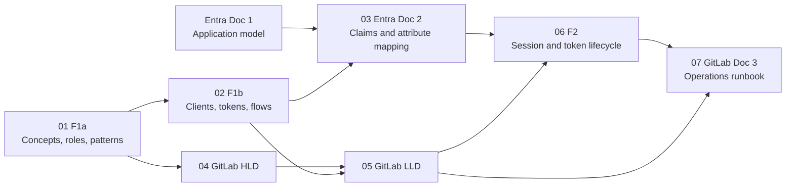

# OIDC & SAML Identity Series — Index and Reading Order

> **Bundle date:** 2026-11-07 · **Environment focus:** Entra ID, AWS GovCloud (`aws-us-gov`), GitLab self-managed · **Format:** Markdown + Mermaid
> **Lens:** high-level concept and problem → pattern → low-level implementation → operations, with authentication and authorization kept separate under Zero Trust.

---

## 1. Reading order

| # | Document | Layer | Answers | Prerequisites | In this zip |
|---|---|---|---|---|---|
| **01** | `01_F1a_OIDC_vs_SAML_Concepts_Roles_Patterns.md` | Foundations · HLD | What problem each protocol solves; who is who; which pattern; AuthN vs AuthZ | — | ✅ new (split from F1) |
| **02** | `02_F1b_OIDC_vs_SAML_Clients_Tokens_Flows.md` | Foundations · LLD | Client types and authentication; token audiences; every flow; what `state`/`nonce`/PKCE stop | 01 | ✅ new (split from F1) |
| **03** | `03_Entra_Doc2_Claims_and_Attribute_Mapping.md` | Entra · LLD | What Entra must emit for AWS; NameID choice; claims mapping policy in Terraform; **review of the deployed GovCloud policy** | 01, 02, Entra Doc 1 | ✅ new |
| 04 | `GitLab_AWS_OIDC_High_Level_Guide.md` | GitLab · HLD | GitLab → AWS architecture | 01 | ➖ in the project, unchanged |
| 05 | `GitLab_AWS_OIDC_Low_Level_Implementation_Guide.md` | GitLab · LLD | Trust policies, STS validation, CI implementation | 02, 04 | ➖ in the project, unchanged |
| **06** | `06_F2_Session_and_Token_Lifecycle.md` | Foundations · cross-cutting | How long trust lasts; the Session Stack; the revocation gap; Entra and AWS lifetime controls. Absorbs the planned SAML session-lifecycle doc | 01–03 | ✅ new |
| **07** | `07_GitLab_Doc3_Operations_Runbook.md` | GitLab · Ops | Kill-switch ladder; revocation; key/thumbprint rotation; IR playbooks; Splunk detections | 05, 06 | ✅ new |

**Entra Doc 1 (Application Model)** was drafted earlier but isn't stored in this project. Doc 2 opens with a short recap of the objects it relies on.

---

## 2. Verify before you apply

These items depend on undocumented, version-specific, or environment-specific behavior. Each doc marks them **VERIFY**.

| Doc | Item | Why | How to verify |
|---|---|---|---|
| 03 §9 #4 | **`RoleSessionName` absent** from the deployed claims mapping policy (as captured in the July diff) | AWS rejects assertions without it ("RoleSessionName is required in AuthnResponse") | SAML-tracer; `GET /servicePrincipals/{id}/claimsMappingPolicies` |
| 03 §9 #2 | NameID entry uses `Format` / `XmlVersion` | Neither property appears in Microsoft's published claims-mapping schema | SAML-tracer: `<NameID Format=…emailAddress>` |
| 03 §9 #5 | `groups` uses a restricted SAML claim URI | Restricted URIs can't be used as claim types; AWS doesn't consume groups anyway | Remove it; confirm the assertion |
| 03 §9 #9 | Identifier = per-provider ACS URL | Audience, Recipient, and trust-policy `SAML:aud` must all agree | SAML-tracer vs the trust policy |
| 03 §7 · 06 §6.1 | `SessionDuration` vs role `MaxSessionDuration` | AWS doesn't document how they interact for SAML console sign-in | Set max ≥ duration; test sign-in |
| 06 §4.2 | OIDC Back-Channel Logout support in Entra | Not confirmed in this review | Current Entra docs |
| 07 RB-7 | GitLab signing-key rotation | No vendor-documented zero-downtime procedure found | GitLab Support for your version |
| 07 RB-8 | DoD PKI chain vs AWS trusted root library | The thumbprint may be load-bearing | Non-prod canary after a test cert change |
| 07 §5.2 | Splunk field paths | Depend on add-on version and extraction | Run Q1 against a known exchange |

---

## 3. What changed from the original F1

| Change | Detail |
|---|---|
| Split | F1 → **F1a** (Parts A + C: HLD and the AuthN/AuthZ framing) and **F1b** (Parts B + D: mechanics, missed points, references) |
| Cross-references | Updated to `F1a §x` / `F1b §x` and to the new docs |
| Correction | The Entra "Allow public client flows" toggle is now described accurately: it enables device code, ROPC, and IWA. Platform type is what makes a client public |
| Added | F1a §6, a glossary of named patterns used across the series |

The original `claude/F1_OIDC_vs_SAML_Roles_Clients_Flows.md` in the project is superseded by 01 + 02.

---

## 4. Conventions

| Convention | Value |
|---|---|
| Account / role placeholders | `111122223333` (Entra docs), `123456789012` (GitLab docs) · `GitLab-Prod-Deploy` · `Snbx-ReadOnly` |
| Partition / region | `arn:aws-us-gov` · `us-gov-west-1` |
| Issuer host | `gitlab.example.mil` |
| Markers | **VERIFY** = confirm before relying on it · ✅ / ➖ = included / not included in this zip |
| Diagrams | Mermaid; every block parse-checked with Mermaid 11 |
