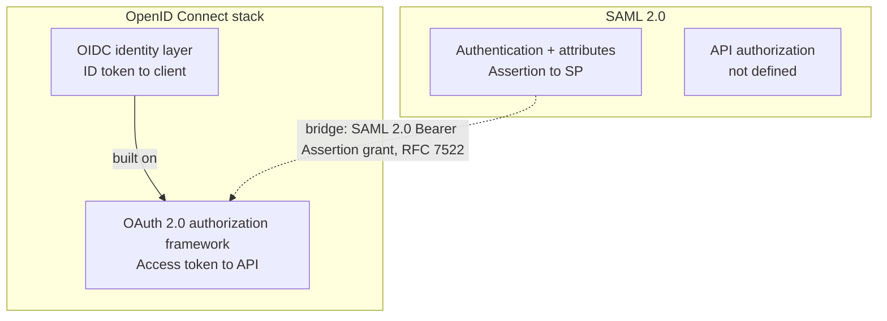
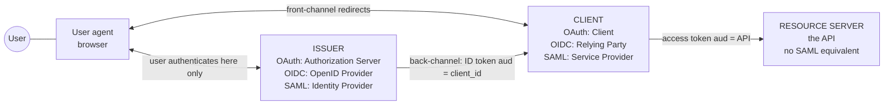
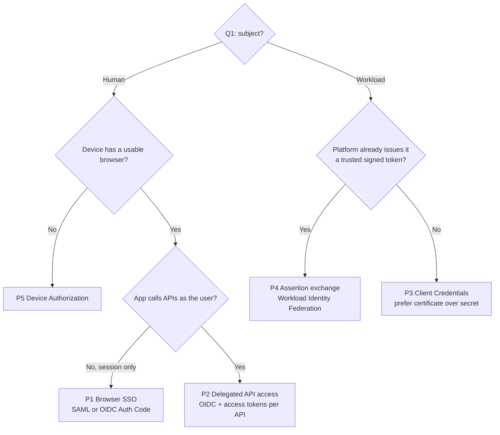
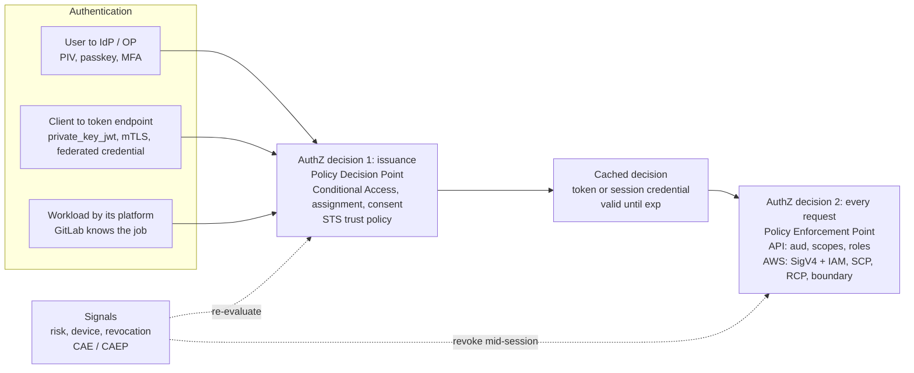

# F1a — OIDC vs SAML: Concepts, Roles, and Patterns (HLD)

> **Series position:** Foundations · **F1a** (1 of 2) → read next: **F1b — Clients, Tokens, Flows, and Protections (LLD)**.
> **Scope:** what problem each protocol solves, who is who, which federation pattern applies, and where authentication ends and authorization begins. No wire-level detail here; that is F1b.
> **Audience:** identity, cloud, and platform engineers fluent in SAML who want OIDC/OAuth terminology to stop moving.
> **Last verified:** 2026-11-07

---

## TL;DR — six statements that remove most of the confusion

1. **"Client" means the application that wants tokens — never the browser, never the user.** The browser is the *user agent*. SAML calls the same application the *Service Provider*; OIDC calls it the *Relying Party*; OAuth calls it the *client*. Three names, one box.
2. **OAuth 2.0 is authorization (delegated API access). OIDC is authentication layered on OAuth. SAML is authentication + attributes with no API-authorization layer at all.**
3. **Every token has exactly one intended consumer — its audience.** ID token → the client. Access token → the API. SAML assertion → the SP. Presenting a token to the wrong consumer is the most common design defect.
4. **A "flow" is only *how the client obtains tokens*.** Three facts choose it: is a human present, can the client keep a secret, does the device have a usable browser.
5. **Client Credentials is not OIDC** (no user, no ID token). **GitLab→AWS is not an OIDC login either** — it uses an OIDC ID token the way SAML uses an assertion.
6. **Authentication is an event; authorization is a per-request decision.** Tokens are *cached authorization decisions*, and almost all are bearer. Zero Trust work is mostly about shortening, revoking, or binding that cache (→ F2).

---

## 1. What problem each protocol actually solves

| | SAML 2.0 | OAuth 2.0 | OpenID Connect | AWS STS (comparison) |
|---|---|---|---|---|
| **Question answered** | Who is this user, with what attributes — for one SP? | May this **client** call this **API**, with what scope? | Who is this user — for one **client** — plus OAuth API access | Exchange a trusted statement for AWS-native credentials |
| **Category** | Federated authentication | Delegated authorization framework | Authentication layer on OAuth | Credential exchange service |
| **Primary output** | Assertion | Access token (+ refresh token) | ID token (+ OAuth tokens) | Session credentials (key ID, secret, session token) |
| **Consumer** | SP | Resource server (API) | Client (RP) | Every AWS API, via SigV4 |
| **Design center** | 2005 · enterprise browser SSO | 2012 · third-party API access | 2014 · web, mobile, API ecosystems | — |

**Why OIDC had to exist.** OAuth 2.0 was widely misused as login: "I received an access token, therefore the user authenticated to *me*." An access token is addressed to an API, not to the client — it tells the client nothing reliable about who the user is, when they authenticated, or whether the token was even issued for this client. OIDC adds a token **addressed to the client** — the ID token — with defined claims (`iss`, `sub`, `aud`, `nonce`, `auth_time`, `acr`, `amr`).

**Why SAML stops at the session.** SAML has no resource-server role. It delivers identity to an SP, the SP creates its own session, and anything after that (calling APIs) needs a different mechanism. This — not XML vs JSON — is the real reason OAuth/OIDC dominates API and microservice architectures.

---

## 2. The HLD lens — the Four-Question Model

Answer these before choosing a protocol or flow. Every design in this series — SAML SSO, OIDC login, GitLab→AWS, Entra workload federation — falls out of them.

| # | Question | What it decides |
|---|---|---|
| **Q1** | **Who is the subject?** Human or workload? | Human → interactive flow with an authorization endpoint. Workload → no browser, no consent, no "user" ID token. |
| **Q2** | **Who consumes the proof, and what does it do with it?** | Create a session (SP/RP) · authorize an API call (resource server) · mint new credentials (STS/token service). This *is* the audience. |
| **Q3** | **How does the proof travel?** | Front-channel (through the browser — attacker-observable) vs back-channel (server-to-server TLS) vs handed directly to a workload. Drives signing, encryption, and PKCE needs. |
| **Q4** | **Can the presenter keep a secret?** | Confidential vs public client — whether the client can authenticate itself, and therefore which flow (F1b §1.2). |

---

## 3. Roles — the Rosetta Stone

This table is the fix for the "client" confusion.

| Neutral concept | SAML 2.0 | OAuth 2.0 | OIDC | Entra ID | AWS (human SSO) | GitLab → AWS |
|---|---|---|---|---|---|---|
| Entity being identified | Principal / Subject | Resource Owner | End-User | User or service principal | Federated user | The CI **job** (`sub` = project + ref) |
| Software the human drives | User agent (browser) | User agent | User agent | Browser / broker | Browser | — none |
| Issues the identity proof | **Identity Provider** | **Authorization Server** | **OpenID Provider** | Entra ID | External IdP | **GitLab** issuer |
| App that receives identity and builds a session | **Service Provider** | **Client** | **Relying Party** (= the OAuth client) | App registration | AWS sign-in (SAML SP) | — |
| Protected API enforcing access | *no SAML role* | **Resource Server** | Resource Server (from OAuth) | API app registration ("Expose an API") | AWS service APIs | AWS service APIs |
| Token / credential broker | — | AS token endpoint | OP token endpoint | Entra token endpoint | STS `AssumeRoleWithSAML` | STS `AssumeRoleWithWebIdentity` |

> **Precise definition — client.** An application that requests tokens from the authorization server, identified by a registered `client_id`, in order to call protected resources on behalf of a user or as itself. "Client" implies nothing about where it runs: a server-side web app, a SPA, a CLI, and a daemon are all clients.
>
> **The HTTP-client trap.** In networking, "client" means whatever opens the connection — usually the browser. In OAuth, the browser is the *user agent*, and the web **server** is the client. Reading OAuth docs with the HTTP meaning in your head is the root of most "which one is the client?" confusion.
>
> **A client is not:** the user · the browser · the API · the IdP. One application *can* be a client to one API and a resource server to its own callers (F1b §1.4).

---

## 4. Federation patterns (named)

| Pattern | Subject | Presenter → consumer | Protocol options | Examples in this stack |
|---|---|---|---|---|
| **P1 · Browser SSO** (session establishment) | Human | Browser → app (SP / RP) | SAML Web Browser SSO · OIDC Auth Code | Entra → AWS console (SAML) · Entra → internal web app (OIDC) |
| **P2 · Delegated API access** | Human, via an app | Client → API | OAuth Auth Code + PKCE → access token · OBO / Token Exchange downstream | Web app calling Microsoft Graph as the signed-in user |
| **P3 · Service identity** (M2M) | Workload with its own credential | Client → API | OAuth Client Credentials | Daemon calling an API with application permissions |
| **P4 · Assertion exchange** (Workload Identity Federation) | Workload or human already authenticated by another issuer | Token from issuer A → token service B → B-native credential | STS `AssumeRoleWithWebIdentity` / `AssumeRoleWithSAML` · Entra federated credentials · RFC 7522/7523 · RFC 8693 | GitLab job → AWS STS · GitHub Actions → Entra |
| **P5 · Input-constrained login** | Human on a device without a usable browser | Device polls AS; human approves elsewhere | Device Authorization Grant (RFC 8628) | `aws sso login --use-device-code` · `az login --use-device-code` |

**HLD observation.** P1 is the only pattern SAML covers natively. P2 and P3 are OAuth. **P4 is where SAML and OIDC converge** — both become "a signed, audience-restricted statement exchanged for local credentials."

---

## 5. Authentication vs Authorization under Zero Trust

### 5.1 Separate them precisely

| | Authentication (AuthN) | Authorization (AuthZ) |
|---|---|---|
| **Question** | Is this subject who or what it claims to be? | May this subject perform this action on this resource, **now**? |
| **Inputs** | Authenticator: PIV/CAC, passkey, certificate, platform-issued workload token | Identity + claims + device/workload posture + resource policy + context |
| **Where** | IdP/OP (user) · token endpoint (client) · platform issuer (workload) | At issuance (AS / STS policy) **and** at every request (resource / PEP) |
| **Artifact** | ID token / SAML assertion — the *result* of AuthN | Access-token scopes/roles · IAM session + policies |
| **Cadence** | Per session | Per request (the Zero Trust goal) |

### 5.2 Where decisions happen — mapped to NIST SP 800-207

### 5.3 Zero Trust implications

- **Tokens are cached authorization decisions.** Between issuance and `exp`, the resource trusts a decision made earlier. Zero Trust asks how stale that decision may be. Levers: short lifetimes · **Continuous Access Evaluation** (Entra CAE for supporting resources; the OpenID Shared Signals Framework / CAEP as the open standard) · per-request policy at the resource. F2 quantifies this as the **revocation gap**.
- **Conditional Access is authorization at issuance, per resource.** Entra evaluates CA when issuing a token for a *target resource* — a user can hold a valid session and still be refused a token for a specific API. Authorization logic lives inside the "authentication" product; keep that clear in designs and documents.
- **Authentication strength travels as claims, and the RP must check it.** `acr`/`amr` in OIDC and `AuthnContextClassRef` in SAML. If an application requires phishing-resistant authentication and never checks these, it is trusting the IdP's default policy rather than enforcing its own.
- **The bearer gap.** SAML assertions, ID tokens, access tokens, and AWS session credentials are all bearer by default: possession equals authority. Closing it requires sender-constraint — DPoP (RFC 9449), certificate-bound tokens (RFC 8705), the SAML Holder-of-Key Web Browser SSO profile. NIST SP 800-63C-4 makes this the dividing line for **FAL3**: the RP must verify the subscriber controls an authenticator via a holder-of-key assertion or a bound authenticator.
- **AWS is the cleanest example of per-request AuthN + AuthZ.** Every API call is authenticated (SigV4 signature) and fully authorized (identity policy, session policy, boundary, SCP/RCP, resource policy). The remaining weakness is that session credentials are bearer — constrain lifetime and use network-perimeter policy conditions (e.g., `aws:SourceVpce`) where feasible.
- **Workload identity is identity.** Workload Identity Federation removes the stored secret, but the issued token is still bearer: pin `sub` and `aud`, keep lifetimes short, isolate runners (DoD ZT *Application & Workload* pillar).

---

## 6. Named patterns used across the series

| Name | One-line meaning | Defined in |
|---|---|---|
| **Four-Question Model** | Subject · consumer · channel · secret-keeping decide protocol and flow | F1a §2 |
| **HTTP-client trap** | Reading "client" as the browser instead of the application | F1a §3 |
| **Two-Authentication Rule** | Confidential code flow authenticates the user *and* the client | F1b §1.3 |
| **ID token as assertion** | P4 uses an OIDC ID token exactly like a SAML assertion | F1b §3.4 |
| **Claim-fidelity trap** | Each credential re-issue hop can drop the original subject's claims | F1b §1.4 · GitLab HLD §6 |
| **Claim Contract** | Every claim = source → transform → emitted name → consumer → decision | Entra Doc 2 §1 |
| **Attribution chain** | NameID → RoleSessionName → SourceIdentity ties AWS activity to a human | Entra Doc 2 §5.4 |
| **Session Stack** | Up to five independent cached-trust layers, each with its own clock | F2 §2 |
| **Revocation gap** | Time between a decision changing and every cached copy expiring | F2 §7 |
| **Two-lever rule** | Trust edits stop the *next* exchange; revocation stops the *current* session | GitLab Doc 3 §1 |
| **Kill-switch ladder** | Containment levers ordered from narrowest to broadest blast radius | GitLab Doc 3 §2 |

## 7. Where to go next

| If your question is… | Read |
|---|---|
| Which client type, which grant, what does each token contain, what does `state` vs `nonce` vs PKCE stop? | **F1b** |
| Which attributes Entra must emit for AWS, NameID choice, claims mapping policy in Terraform | **Entra Doc 2** |
| How long does trust last after sign-in, and how do I kill it? | **F2** |
| GitLab→AWS architecture and implementation | **GitLab HLD → GitLab LLD** |
| What do I do at 02:00 when a deploy role is abused? | **GitLab Doc 3** |

---

## References

1. RFC 6749 — The OAuth 2.0 Authorization Framework. https://www.rfc-editor.org/rfc/rfc6749
2. OpenID Connect Core 1.0. https://openid.net/specs/openid-connect-core-1_0.html
3. SAML 2.0 Core. https://docs.oasis-open.org/security/saml/v2.0/saml-core-2.0-os.pdf
4. SAML 2.0 Profiles (Web Browser SSO). https://docs.oasis-open.org/security/saml/v2.0/saml-profiles-2.0-os.pdf
5. RFC 7522 / 7523 — SAML 2.0 and JWT profiles for OAuth assertion grants. https://www.rfc-editor.org/rfc/rfc7522 · https://www.rfc-editor.org/rfc/rfc7523
6. RFC 8628 — Device Authorization Grant. https://www.rfc-editor.org/rfc/rfc8628
7. RFC 8693 — Token Exchange. https://www.rfc-editor.org/rfc/rfc8693
8. RFC 8705 — Mutual-TLS Client Authentication and Certificate-Bound Access Tokens. https://www.rfc-editor.org/rfc/rfc8705
9. RFC 9449 — Demonstrating Proof of Possession (DPoP). https://www.rfc-editor.org/rfc/rfc9449
10. NIST SP 800-207 — Zero Trust Architecture. https://csrc.nist.gov/pubs/sp/800/207/final
11. NIST SP 800-63C-4 — Federation and Assertions (FAL1–FAL3). https://pages.nist.gov/800-63-4/sp800-63c.html
12. OpenID Shared Signals Working Group (SSF, CAEP, RISC). https://openid.net/wg/sharedsignals/
13. Microsoft Entra — Continuous access evaluation. https://learn.microsoft.com/entra/identity/conditional-access/concept-continuous-access-evaluation
14. AWS CLI adds PKCE-based authorization for SSO (default from v2.22.0). https://aws.amazon.com/blogs/developer/aws-cli-adds-pkce-based-authorization-for-sso/
