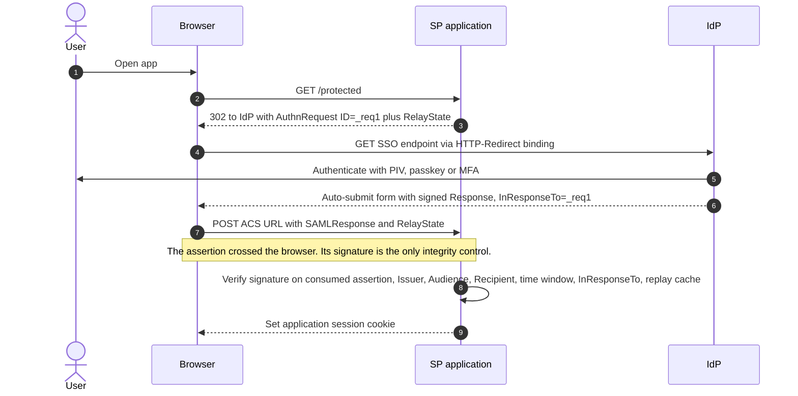
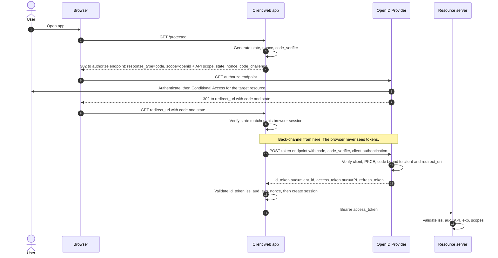
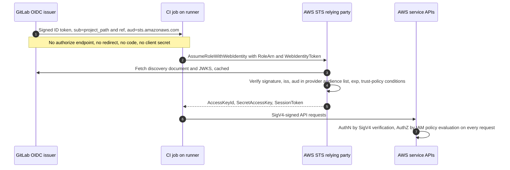

# F1b — OIDC vs SAML: Clients, Tokens, Flows, and Protections (LLD)

> **Series position:** Foundations · **F1b** (2 of 2) ← read first: **F1a — Concepts, Roles, and Patterns (HLD)**.
> **Scope:** the mechanics behind F1a — client identity and authentication, token audiences, every grant/flow, and what each protocol control actually stops.
> **Last verified:** 2026-11-07

---

## 1. The client in depth

### 1.1 Client identity — SAML ↔ OIDC registration mapping

| What the IdP must know about the app | SAML | OIDC / OAuth | Entra field |
|---|---|---|---|
| App identifier | Entity ID (SP `Issuer`) | `client_id` | Application (client) ID · SAML: Identifier (Entity ID) |
| Where to deliver the result | ACS URL | `redirect_uri` (exact match) | Redirect URIs · SAML: Reply URL (ACS) |
| Audience value in the result | `<AudienceRestriction>` = Entity ID | ID token `aud` = `client_id` | — |
| How the app proves itself | Optional signed AuthnRequest | Client authentication at token endpoint | Certificates & secrets · Federated credentials |
| How the app learns IdP keys | IdP metadata `<KeyDescriptor>` | Discovery → `jwks_uri` | Federation metadata URL · `/.well-known/openid-configuration` |

> **Commonly missed:** in SAML Web SSO with HTTP-POST, the **SP never authenticates to the IdP**. The only thing stopping delivery to an impostor is the pre-registered ACS URL. AuthnRequest signing is optional and, even when enabled, protects the *request*, not the response.

### 1.2 Client types — the answer to Q4

| Type | Definition | Examples | Authenticates at token endpoint? | Code-redemption protection |
|---|---|---|---|---|
| **Confidential** | Runs where its credential can't be extracted by users | Server-side web app, API middle tier, daemon | Yes | Client authentication **+ PKCE** (recommended) |
| **Public** | Runs on a user-controlled device; any embedded secret is extractable | SPA, mobile, desktop, CLI (`aws`, `az`) | No (`none`) | **PKCE** (required) |

Entra maps this to platform types: **Web** = confidential; **SPA** and **Mobile & desktop** = public. The separate **Allow public client flows** toggle enables device code, ROPC, and IWA for the app — leave it off unless a headless use case is documented.

> **PKCE is not client authentication.** It proves *the party redeeming this code is the same instance that started this flow*. It does not prove *which application* that is — a public client's `client_id` is a public label anyone can present. Public clients are constrained by redirect-URI rules instead (loopback, custom scheme, exact match).

### 1.3 Client authentication methods — weakest to strongest

| Method | Mechanism | Zero Trust posture |
|---|---|---|
| `none` | Public client, PKCE only | No client identity assurance |
| `client_secret_basic` / `client_secret_post` | Shared secret sent to the token endpoint | Long-lived shared secret — the IAM-user-access-key problem again |
| `client_secret_jwt` | JWT HMAC-signed with the shared secret | Secret not transmitted, still shared |
| `private_key_jwt` | JWT signed with client private key; AS holds the public key/cert | Asymmetric; key can live in HSM / KMS / Key Vault |
| `tls_client_auth` / `self_signed_tls_client_auth` (RFC 8705) | Mutual TLS | Asymmetric; also enables certificate-bound tokens |
| **Federated credential** (`client_assertion` from a trusted external issuer) | Workload presents its platform's token (GitLab, GitHub, Kubernetes) | **No stored secret** — pattern P4 applied to client authentication |

> **The Two-Authentication Rule.** In Auth Code flow with a confidential client, two independent authentications happen:
> 1. The **user** authenticates to the OP — front-channel, in the browser (PIV/CAC, passkey, MFA).
> 2. The **client** authenticates to the OP's token endpoint — back-channel (secret, `private_key_jwt`, mTLS).
>
> SAML POST has only the first. Documents that say "OIDC authenticates the user" and stop there hide half the trust model.

### 1.4 One application, two roles — the middle tier

API A receives a user's access token (A is a **resource server**) and must call API B as that user (A is now a **client**).

| Option | Behavior | Verdict |
|---|---|---|
| Forward the incoming token to B | Token `aud` = A, presented to B | **Audience violation** — B must reject it |
| A uses Client Credentials to call B | User context lost; A acts with its own app permissions | **Confused deputy** — any user reaching A gets A's rights at B |
| **On-Behalf-Of** (Entra) / **Token Exchange** (RFC 8693) | A exchanges the incoming token for a new token with `aud` = B; user identity preserved, B's scopes re-evaluated | **Correct** |

This is the same **claim-fidelity trap** the GitLab HLD §6 documents for central entry-role chaining: each hop that re-issues credentials can drop the original subject's claims.

---

## 2. Tokens and audiences

| Artifact | Issued by | Audience | Consumed by | Consumer validates | Must never |
|---|---|---|---|---|---|
| **SAML assertion** | IdP | SP Entity ID | SP | Signature on *the consumed* assertion, Issuer, Audience, Recipient/Destination, NotBefore/NotOnOrAfter, InResponseTo, assertion-ID replay | Be forwarded to APIs as authorization |
| **ID token** | OP | `client_id` of the RP | Client | `iss`, `aud` (+ `azp` if multiple audiences), `exp`, `iat`, `nonce`, allowed `alg` | Be sent to an API as a bearer credential |
| **Access token** | AS | The API | Resource server | Signature, `iss`, `aud` = itself, `exp`, scopes/roles — or introspection if opaque | Be parsed or relied on by the client |
| **Refresh token** | AS | The AS itself | AS only | Client binding (confidential: client auth · public: rotation or sender-constraint) | Leave the client or reach an API |
| **AWS session credentials** | STS | — (signing material, not a token) | Every AWS API via SigV4 | Signature, session validity, full policy evaluation | Be logged or saved to artifacts |

**Key points**

- **Audience discipline.** `aud` binds a token to one consumer. A JWT that verifies perfectly but carries another app's `aud` is a token-substitution attack, not a valid login. *Signature valid ≠ token valid for me.*
- **Access tokens are opaque to the client by contract.** Only the resource server interprets them. Entra advises against validating or reading tokens for APIs you don't own; tokens for Microsoft APIs may use a format that won't validate as a standard JWT. In Entra v2 access tokens, `aud` is the API's client ID and `azp` is the calling client.
- **Subject identifiers are issuer-scoped and may be pairwise.** In Entra, `sub` is unique **per user per application**; `oid` is the tenant-wide immutable user ID. Two apps see different `sub` values for the same person. When migrating from SAML NameID to OIDC, choose deliberately what accounts are keyed on (`oid` + `tid` for cross-app correlation, `sub` for app-local identity). Entra Doc 2 §10 covers the SAML→OIDC claim mapping.
- **ID token signature — why delivery channel matters.** OIDC Core §3.1.3.7 allows a client that received the ID token *directly from the token endpoint over TLS* to rely on TLS server validation for issuer authenticity; ID tokens received any other way **must** be signature-validated. Libraries validate anyway — keep it — but this explains the design: back-channel delivery removes the browser from the trust path. A SAML POST assertion is *always* front-channel, so its signature is the only integrity control.

---

## 3. Flows — precise definitions

### 3.1 What "flow" actually means — three knobs plus one switch

| Knob | Where | Values | SAML analog |
|---|---|---|---|
| **Grant type** | Token endpoint `grant_type` | `authorization_code`, `client_credentials`, `refresh_token`, `urn:ietf:params:oauth:grant-type:device_code`, `…:jwt-bearer`, `…:saml2-bearer`, `…:token-exchange` | Profile (e.g., Web Browser SSO) |
| **Response type** | Authorization endpoint `response_type` | `code` (Auth Code) · `id_token`, `id_token token` (Implicit) · `code id_token` etc. (Hybrid) | What the IdP returns |
| **Response mode** | Authorization endpoint `response_mode` | `query`, `fragment`, `form_post` | Binding (`form_post` ≈ HTTP-POST binding) |
| **The OIDC switch** | `scope` contains `openid` | Present → OIDC, ID token issued · absent → plain OAuth, no ID token | — |

> **Commonly missed:** the Authorization Code flow is not a new idea. SAML's **HTTP-Artifact binding** does the same thing — the browser carries a short reference (artifact), and the SP resolves it to the assertion over a back-channel SOAP `ArtifactResolve`. It is rarely deployed; most cloud IdPs return SAML Responses via HTTP-POST only.

### 3.2 Flow catalog

| Flow | `grant_type` | Human? | Client type | ID token? | Status (RFC 9700 BCP · OAuth 2.1 draft) | Example |
|---|---|---|---|---|---|---|
| **Authorization Code + PKCE** | `authorization_code` | Yes | Confidential or public | If `openid` | **Default for every user-facing app** | Web app, SPA, `aws sso login` (default since AWS CLI v2.22.0) |
| Hybrid (`code id_token`) | `authorization_code` | Yes | Confidential | Yes (front + back channel) | Valid, niche — prefer plain `code` | Older ASP.NET OWIN apps on Entra |
| Implicit | none (tokens from `/authorize`) | Yes | Public | Yes, front-channel | **Deprecated** — tokens exposed in URL fragment | Legacy SPAs (MSAL.js 1.x) |
| Resource Owner Password | `password` | Yes | Any | Optional | **Prohibited by BCP** — client handles the password; defeats MFA, federation, phishing-resistant auth | Legacy scripts |
| Device Authorization | `…:device_code` | Yes, on another device | Public | If `openid` | Valid only where no browser exists; phishable by design (RFC 8628 §5.4) | `--use-device-code`, headless hosts |
| **Client Credentials** | `client_credentials` | **No** | Confidential only | **No — not OIDC** | Valid for M2M | Daemons, service-to-service |
| Refresh Token | `refresh_token` | Renewal | Either | Sometimes | Valid; public clients must rotate or sender-constrain | Session renewal (F2 §4) |
| JWT / SAML 2.0 Bearer assertion grants (RFC 7523 / 7522) | `…:jwt-bearer` / `…:saml2-bearer` | Depends | Usually confidential | Depends | Valid | Entra OBO (JWT-bearer shape) · Entra SAML bearer flow |
| Token Exchange (RFC 8693) | `…:token-exchange` | Depends | Usually confidential | Depends | Valid | Middle-tier delegation |
| AWS `AssumeRoleWithWebIdentity` | Proprietary STS API, same P4 pattern | No (workload) | No client authentication | Consumes one; issues AWS credentials | Valid | GitLab → AWS |

> **Device code caveat:** because the user approves on a different device than the one receiving tokens, an attacker can start the flow and socially engineer a victim into approving it. Entra Conditional Access can restrict device code flow — do so unless a documented headless use case exists.

### 3.3 Side by side — SAML SP-initiated vs OIDC Auth Code + PKCE

**SAML Web Browser SSO (SP-initiated, HTTP-POST)**

**OIDC Authorization Code + PKCE (confidential client calling an API)**

| Stage | SAML Web SSO (POST) | OIDC Auth Code + PKCE |
|---|---|---|
| Request correlation | AuthnRequest `ID` → Response `InResponseTo` | `state` (browser binding) · `nonce` (token binding) |
| What returns through the browser | The full signed assertion — PII-bearing unless encrypted | A short-lived, single-use code |
| Who delivers the identity statement | Browser (front-channel) | OP directly, over TLS (back-channel) |
| App authenticates to the IdP | No | Yes (confidential) · PKCE only (public) |
| Value of an intercepted artifact | Replayable until `NotOnOrAfter` unless the SP keeps a replay cache | Useless without `code_verifier` (+ client credential) |
| API authorization | Out of scope | Separate access token per API audience |

### 3.4 Machine flows — Client Credentials vs Workload Identity Federation

**Client Credentials (P3):** the workload authenticates with *its own* stored credential at the token endpoint and receives an access token. No user, no `openid`, no ID token. Authorization comes from **application permissions** (Entra: app roles granted by admin consent → `roles` claim) — the app acts as itself, not on anyone's behalf.

**Workload Identity Federation (P4):** the workload has *no* credential of its own. Its platform already knows exactly which job is running and issues a signed token about it. The workload presents that token to a token service that trusts the platform.

| GitLab guide term | Protocol role | Why it matters |
|---|---|---|
| GitLab OIDC issuer | Token issuer (OP) | Its JWKS signing key is the root of trust for every role that trusts it (GitLab Doc 3 RB-7) |
| `id_tokens: aud:` | Audience = intended relying party | Must equal the IAM OIDC provider audience and the trust-policy `aud` condition |
| IAM OIDC provider "Audience" | `ClientIDList` in the IAM API | AWS calls audiences "client IDs" because for human web-identity apps the ID token's `aud` *is* the app's `client_id`. For GitLab it is simply an agreed string |
| Runner / job | Subject (`sub`) and bearer presenter | Not an OAuth client; it never authenticates itself — possession of the token *is* the proof |
| Role trust policy | Relying party acceptance rules | **AuthZ decision 1:** may this subject obtain this role session? |
| Role permission policy, boundary, SCP/RCP | Resource-side authorization | **AuthZ decision 2:** evaluated on every API call |
| Central entry role → `AssumeRole` | Token-exchange chain | **Claim-fidelity trap:** the target role sees an AWS principal, not GitLab claims |

> **Named pattern — "ID token as assertion."** In P4 the OIDC ID token is used exactly as a SAML assertion is used with `AssumeRoleWithSAML`: a signed, audience-restricted bearer statement handed to a relying party that converts it into local credentials. The differences are encoding (JWT vs XML), key distribution (JWKS fetch vs uploaded metadata), and audience semantics. That is why the GitLab→AWS documents feel like neither "OIDC login" nor "OAuth" — they are neither.

---

## 4. Protocol protections — what each control actually stops

| Control | Protocol | Generated → verified | Stops | Common misreading |
|---|---|---|---|---|
| `state` | OAuth / OIDC | Client → client (round-trips via browser) | CSRF on the redirect endpoint; login CSRF; code injected into a victim's session | "A return URL" — it is a CSRF token bound to the browser session |
| `nonce` | OIDC | Client → client (OP echoes it inside the ID token) | ID-token replay or injection into another session | "Same as state" — `state` protects the redirect, `nonce` protects the token |
| PKCE `code_challenge` / `code_verifier` | OAuth (RFC 7636) | Client → AS | Code interception and code injection | "Authenticates the client" — it binds the code to one flow instance |
| `InResponseTo` | SAML | SP's AuthnRequest `ID` → SP | Unsolicited or injected responses in SP-initiated SSO | Absent in **IdP-initiated** SSO — that mode carries inherent injection / login-CSRF exposure |
| `RelayState` | SAML | SP → SP, opaque, max 80 bytes | Nothing — state preservation only | Treated as a security control; unvalidated, it becomes an open redirect |
| Assertion `ID` + replay cache | SAML | IdP → SP | Assertion replay inside the validity window | Often not implemented — verify your SP library |
| `aud` / `AudienceRestriction` | Both | Issuer → consumer | Token substitution across applications | Signature check alone treated as validation |
| `alg` allow-list | JWT | Consumer configuration | `alg: none` and algorithm-confusion attacks | Letting the token header choose the algorithm |
| Validate-what-you-consume | SAML | SP | XML Signature Wrapping | Verifying *a* signature somewhere in the document instead of the one covering the consumed assertion |

RFC 9700 nuance: PKCE is **required** for public clients and **recommended** for confidential clients; a confidential OIDC client may rely on `nonce` for code-injection protection, but PKCE is the uniform control and should be the default.

---

## 5. Points most documents miss

| # | Point | Where |
|---|---|---|
| 1 | "Client" is the **application**, never the browser — beware the HTTP-client trap | F1a §3 |
| 2 | SP ≡ RP ≡ OAuth client: one box, three vocabularies | F1a §3 |
| 3 | SAML has **no resource-server role** — the real reason OAuth/OIDC owns API architectures | F1a §1 |
| 4 | **Two-Authentication Rule:** confidential code flow authenticates the user *and* the client | F1b §1.3 |
| 5 | **PKCE ≠ client authentication** — it binds a code to a flow instance | F1b §1.2 |
| 6 | **Client Credentials is not OIDC** — no user, no ID token | F1b §3.2 |
| 7 | Auth Code flow ≈ **SAML HTTP-Artifact binding** | F1b §3.1 |
| 8 | Back-channel ID tokens vs front-channel assertions change what the signature is protecting | F1b §2 |
| 9 | `state` ≠ `nonce` ≠ PKCE; **RelayState is not a security control** | F1b §4 |
| 10 | Access tokens are **opaque to the client** | F1b §2 |
| 11 | `sub` is issuer-scoped and may be **pairwise** — Entra `sub` per app vs `oid` per tenant | F1b §2 |
| 12 | AWS "client ID list" on an OIDC provider = **allowed audiences** | F1b §3.4 |
| 13 | GitLab→AWS is **"ID token as assertion"** (P4), not an OIDC login | F1b §3.4 |
| 14 | Middle tier: forwarding a token = audience violation; Client Credentials = confused deputy; use OBO / Token Exchange | F1b §1.4 |
| 15 | **Conditional Access is AuthZ at issuance**, per target resource | F1a §5.3 |
| 16 | RPs must check `acr`/`amr` / `AuthnContextClassRef` to enforce authentication strength | F1a §5.3 |
| 17 | Everything is **bearer** by default — FAL3, DPoP, mTLS-bound, and HoK close the gap | F1a §5.3 |

## 6. Sharpening the source SAML-vs-OIDC comparison

| Source statement | Sharpened |
|---|---|
| Client Credentials listed under "OIDC has multiple flows" | OAuth only — no ID token, no user. |
| SAML transport "usually browser redirects and POST" | Also HTTP-Artifact (back-channel resolution) — SAML's equivalent of the code flow. |
| Flow list stops at four | Add Device Authorization, Hybrid, Refresh, Token Exchange / OBO, SAML2 / JWT bearer grants; ROPC is prohibited by RFC 9700. |
| "OIDC supports dynamic key discovery; SAML relies on metadata distribution" | SAML metadata can also be fetched by URL and refreshed (Entra federation metadata URL) and can carry multiple certificates. The practical difference is JWKS `kid`-based key selection and on-demand refresh when an unknown `kid` appears. |
| SAML CSRF protection: "request correlation" | True for SP-initiated only (`InResponseTo`). IdP-initiated has no correlation. |
| "ID token is intended for the client" | Correct — add the converse: access tokens are opaque to the client. |

---

## 7. References

**Standards — OAuth 2.0 / OIDC**

1. RFC 6749 — The OAuth 2.0 Authorization Framework. https://www.rfc-editor.org/rfc/rfc6749
2. RFC 6750 — Bearer Token Usage. https://www.rfc-editor.org/rfc/rfc6750
3. RFC 7636 — Proof Key for Code Exchange (PKCE). https://www.rfc-editor.org/rfc/rfc7636
4. RFC 8252 — OAuth 2.0 for Native Apps. https://www.rfc-editor.org/rfc/rfc8252
5. RFC 8628 — Device Authorization Grant. https://www.rfc-editor.org/rfc/rfc8628
6. RFC 8693 — Token Exchange. https://www.rfc-editor.org/rfc/rfc8693
7. RFC 7521 / 7522 / 7523 — Assertion framework; SAML 2.0 profile; JWT profile. https://www.rfc-editor.org/rfc/rfc7521 · https://www.rfc-editor.org/rfc/rfc7522 · https://www.rfc-editor.org/rfc/rfc7523
8. RFC 8705 — Mutual-TLS Client Authentication and Certificate-Bound Access Tokens. https://www.rfc-editor.org/rfc/rfc8705
9. RFC 9068 — JWT Profile for OAuth 2.0 Access Tokens. https://www.rfc-editor.org/rfc/rfc9068
10. RFC 9449 — Demonstrating Proof of Possession (DPoP). https://www.rfc-editor.org/rfc/rfc9449
11. RFC 9700 — Best Current Practice for OAuth 2.0 Security. https://www.rfc-editor.org/rfc/rfc9700
12. OAuth 2.1 (Internet-Draft — not yet an RFC). https://datatracker.ietf.org/doc/draft-ietf-oauth-v2-1/
13. OpenID Connect Core 1.0 (see §3.1.3.7 for ID token validation). https://openid.net/specs/openid-connect-core-1_0.html
14. OpenID Connect Discovery 1.0. https://openid.net/specs/openid-connect-discovery-1_0.html
15. OAuth 2.0 Form Post Response Mode. https://openid.net/specs/oauth-v2-form-post-response-mode-1_0.html

**Standards — SAML 2.0**

16. SAML 2.0 Core. https://docs.oasis-open.org/security/saml/v2.0/saml-core-2.0-os.pdf
17. SAML 2.0 Bindings (HTTP-Redirect, HTTP-POST, HTTP-Artifact; RelayState limit). https://docs.oasis-open.org/security/saml/v2.0/saml-bindings-2.0-os.pdf
18. SAML 2.0 Profiles (Web Browser SSO). https://docs.oasis-open.org/security/saml/v2.0/saml-profiles-2.0-os.pdf
19. SAML V2.0 Holder-of-Key Web Browser SSO Profile — OASIS Committee Specification (cited by name).

**Microsoft Entra ID**

20. ID token claims reference (`sub` pairwise per application, `oid`). https://learn.microsoft.com/entra/identity-platform/id-token-claims-reference
21. Access token claims reference (`aud`, `azp`). https://learn.microsoft.com/entra/identity-platform/access-token-claims-reference
22. On-Behalf-Of flow. https://learn.microsoft.com/entra/identity-platform/v2-oauth2-on-behalf-of-flow
23. SAML bearer assertion flow. https://learn.microsoft.com/entra/identity-platform/v2-saml-bearer-assertion
24. Workload identity federation. https://learn.microsoft.com/entra/workload-id/workload-identity-federation

**AWS and GitLab**

25. IAM API — CreateOpenIDConnectProvider (`ClientIDList`). https://docs.aws.amazon.com/IAM/latest/APIReference/API_CreateOpenIDConnectProvider.html
26. STS API — AssumeRoleWithWebIdentity. https://docs.aws.amazon.com/STS/latest/APIReference/API_AssumeRoleWithWebIdentity.html
27. STS API — AssumeRoleWithSAML. https://docs.aws.amazon.com/STS/latest/APIReference/API_AssumeRoleWithSAML.html
28. AWS CLI adds PKCE-based authorization for SSO (default from v2.22.0; `--use-device-code` fallback). https://aws.amazon.com/blogs/developer/aws-cli-adds-pkce-based-authorization-for-sso/
29. GitLab — OpenID Connect authentication using ID tokens. https://docs.gitlab.com/ci/secrets/id_token_authentication/
30. GitLab — Configure OpenID Connect in AWS. https://docs.gitlab.com/ci/cloud_services/aws/
