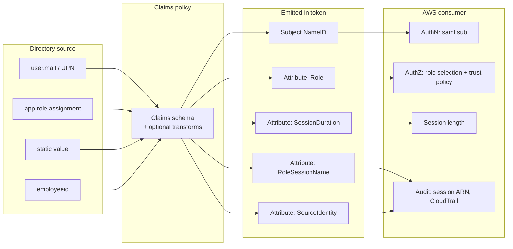
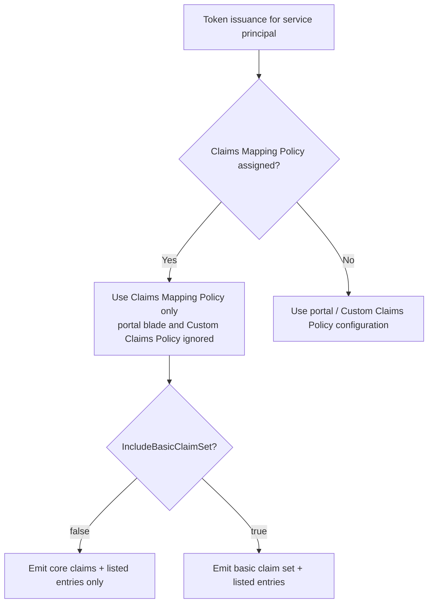
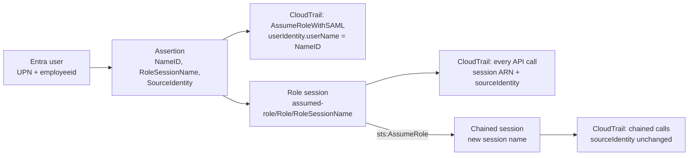
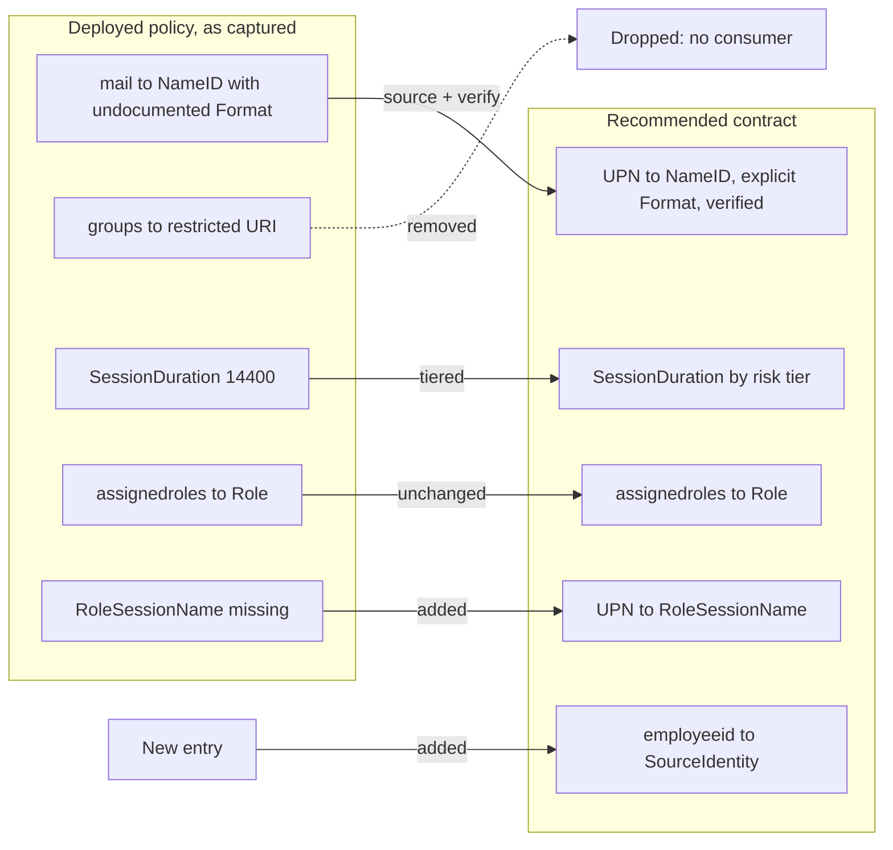

# Entra Doc 2 — Claims & Attribute Mapping (Entra ID → AWS GovCloud SAML, plus the OIDC equivalent)

> **Series position:** Entra series · **Doc 2**. Prerequisites: **F1a §3** (roles), **F1b §2** (tokens and audiences), Entra **Doc 1** (application model).
> **Scope:** how directory attributes become SAML attributes and JWT claims, what AWS requires in an assertion, NameID semantics, the claims mapping policy in Terraform, and a review of the deployed Entra → GovCloud policy.
> **Last verified:** 2026-11-07. Items marked **VERIFY** depend on undocumented or version-specific behavior and must be confirmed in SAML-tracer before you rely on them.

> **Doc 1 recap (the objects this doc assumes).**
> **App registration** = the global definition: identifier URIs, app roles, certificates. **Service principal / Enterprise application** = the tenant instance: SSO mode, SAML signing certificate, user/group assignments, claims-policy assignment. **App roles** are defined on the registration, and their `value` is what lands in tokens. **Assignments** bind a user or group to an app role on the service principal; with `appRoleAssignmentRequired = true`, an unassigned user gets no token at all.

---

## TL;DR

1. **A claim is a contract.** Each one has a source attribute, an emitted name, a consumer, and a decision the consumer makes with it. Most federation failures break that contract; very few are cryptographic.
2. **Split every claim by plane.** AuthN: `NameID`/`sub`. AuthZ: `Role`, `roles`, `groups`, `PrincipalTag`. Session: `SessionDuration`. Audit: `RoleSessionName`, `SourceIdentity`.
3. **AWS needs three things in every assertion:** a `Subject/NameID`, a `Role` attribute (role ARN + provider ARN pair), and a `RoleSessionName`. If any one is missing, sign-in stops.
4. **A Claims Mapping Policy overrides the portal "Attributes & Claims" blade, silently.** With `IncludeBasicClaimSet = false`, anything the policy doesn't list is not emitted.
5. **NameID identifies; it doesn't authorize.** The `Role` attribute picks the AWS role. The trust policy may additionally test `saml:sub`, `saml:aud`, and `saml:iss`.
6. **The deployed GovCloud policy has three findings to resolve** (§9). The policy as captured has no `RoleSessionName`. Its NameID entry uses properties Microsoft doesn't document. Its `groups` URI is in Entra's restricted set.

---

## 1. Problem and pattern (HLD)

**Problem.** The IdP knows directory attributes (`mail`, `userPrincipalName`, app-role assignments). The SP has its own vocabulary: AWS doesn't know what an "app role assignment" is, but it knows `arn:aws-us-gov:iam::…:role/X,arn:aws-us-gov:iam::…:saml-provider/Y`. Claims mapping does two jobs: it **translates** directory data into the SP's vocabulary, and it **minimizes** the token to what the SP actually consumes.

**Named pattern — the Claim Contract.** Write down every claim as one row. If a row has no consumer, delete the claim. If a row has no failure mode written down, you haven't tested it.

| Column | Meaning | Example (AWS `Role`) |
|---|---|---|
| Source | Directory attribute or static value | `user.assignedroles` |
| Transform | Optional Entra transformation | none |
| Emitted as | SAML attribute name / NameID / JWT claim | `https://aws.amazon.com/SAML/Attributes/Role` |
| Consumer | Who reads it | AWS sign-in → STS `AssumeRoleWithSAML` |
| Plane | AuthN · AuthZ · Session · Audit | AuthZ |
| Decision | What the consumer does with it | Selects role + provider; trust policy evaluated |
| Failure mode | What breaks if missing or wrong | "Your request included an invalid SAML response" |



---

## 2. Claim planes for AWS SAML federation

| Assertion element | Plane | What AWS does with it | Where it shows up |
|---|---|---|---|
| `Subject/NameID` | **AuthN** | Becomes `saml:sub`; `Format` drives `saml:sub_type`. A missing NameID produces a 403 on `AssumeRoleWithSAML` | `AssumeRoleWithSAML` event `userIdentity.userName` |
| `Issuer` | AuthN | Must match the IdP entity ID in the IAM SAML provider metadata → `saml:iss` | Provider config |
| `SubjectConfirmationData/@Recipient` | AuthN (audience) | Must match the AWS sign-in endpoint; the source of `saml:aud` | Trust-policy condition |
| `Conditions/AudienceRestriction` | AuthN (audience) | Must equal the SP entity ID AWS expects ("Response does not contain the required audience") | — |
| `Attribute: Role` | **AuthZ** | Role ARN + provider ARN pairs; multiple pairs → role picker | Role chosen |
| `Attribute: PrincipalTag:{Key}` | AuthZ (ABAC) | Session tags; trust policy needs `sts:TagSession` | `aws:PrincipalTag/{Key}` conditions |
| `Attribute: TransitiveTagKeys` | AuthZ (ABAC) | Tags that survive role chaining | Chained sessions |
| `Attribute: SessionDuration` | **Session** | Console session 900–43,200 s; the lesser of this and `SessionNotOnOrAfter` wins | Session expiry |
| `Attribute: RoleSessionName` | **Audit** | Required. Becomes the session name in `assumed-role/<role>/<name>` | Every subsequent CloudTrail event |
| `Attribute: SourceIdentity` | Audit | Immutable for the session; persists across role chaining; trust policy needs `sts:SetSourceIdentity` | `sourceIdentity` on subsequent events |

---

## 3. Configuration surfaces in Entra and precedence

| Surface | How it's managed | Scope | Precedence |
|---|---|---|---|
| **Enterprise app → Single sign-on → Attributes & Claims** | Portal | One service principal | Lowest. Shares the same underlying policy as the Custom Claims Policy |
| **Custom Claims Policy** (Graph, preview) | Graph `PUT` / `PATCH` | One per service principal | Same as the portal blade; edits are interchangeable |
| **Claims Mapping Policy** (`claimsMappingPolicy`) | Graph · Terraform `azuread_claims_mapping_policy` | One policy can be assigned to many apps | **Supersedes both.** Tokens ignore the portal and Custom Claims configuration |
| **Optional claims** (app manifest `optionalClaims`) | Manifest · Terraform `azuread_application` | JWTs for that app registration | OIDC/OAuth tokens only (§10) |



> **Operational consequence — invisible drift.** Once Terraform assigns a Claims Mapping Policy, an admin can still edit claims in the portal. The edit saves without error and changes nothing, because tokens ignore it. Terraform sees no drift either, because the portal writes to a different policy object. Make the portal blade read-only by procedure, and say so in the app's runbook.

---

## 4. SAML assertion anatomy — Entra → AWS GovCloud

```xml
<samlp:Response Destination="https://signin.amazonaws-us-gov.com/saml" InResponseTo="…">
  <Assertion ID="_a1b2" IssueInstant="2026-11-07T14:00:00Z">
    <!-- AuthN: must equal the IdP entityID in the IAM SAML provider metadata (saml:iss) -->
    <Issuer>{Entra issuer from federation metadata entityID}</Issuer>
    <ds:Signature>…</ds:Signature>

    <Subject>
      <!-- AuthN: saml:sub. Format → saml:sub_type -->
      <NameID Format="urn:oasis:names:tc:SAML:1.1:nameid-format:emailAddress">jane.doe@agency.mil</NameID>
      <SubjectConfirmation Method="urn:oasis:names:tc:SAML:2.0:cm:bearer">
        <!-- Recipient must match the AWS sign-in endpoint and is the source of saml:aud -->
        <SubjectConfirmationData NotOnOrAfter="2026-11-07T14:05:00Z"
                                 Recipient="https://signin.amazonaws-us-gov.com/saml"/>
      </SubjectConfirmation>
    </Subject>

    <Conditions NotBefore="2026-11-07T13:55:00Z" NotOnOrAfter="2026-11-07T15:00:00Z">
      <!-- = the Entra app Identifier (Entity ID); must equal what AWS expects -->
      <AudienceRestriction><Audience>urn:amazon:webservices:govcloud</Audience></AudienceRestriction>
    </Conditions>

    <AttributeStatement>
      <!-- AuthZ: role ARN, provider ARN (comma-separated, no spaces) -->
      <Attribute Name="https://aws.amazon.com/SAML/Attributes/Role">
        <AttributeValue>arn:aws-us-gov:iam::111122223333:role/Snbx-ReadOnly,arn:aws-us-gov:iam::111122223333:saml-provider/EntraID</AttributeValue>
      </Attribute>
      <!-- Audit: REQUIRED. [a-zA-Z_0-9+=,.@-]{2,64} -->
      <Attribute Name="https://aws.amazon.com/SAML/Attributes/RoleSessionName">
        <AttributeValue>jane.doe@agency.mil</AttributeValue>
      </Attribute>
      <!-- Session: 900–43200 seconds -->
      <Attribute Name="https://aws.amazon.com/SAML/Attributes/SessionDuration">
        <AttributeValue>3600</AttributeValue>
      </Attribute>
      <!-- Audit (optional): persists across role chaining; needs sts:SetSourceIdentity -->
      <Attribute Name="https://aws.amazon.com/SAML/Attributes/SourceIdentity">
        <AttributeValue>E1234567</AttributeValue>
      </Attribute>
    </AttributeStatement>

    <AuthnStatement AuthnInstant="2026-11-07T13:59:58Z" SessionIndex="_a1b2">
      <AuthnContext><AuthnContextClassRef>…</AuthnContextClassRef></AuthnContext>
    </AuthnStatement>
  </Assertion>
</samlp:Response>
```

> **Timing elements** (`NotOnOrAfter` × 2, `AuthnInstant`, `SessionNotOnOrAfter`) are covered in **F2 §3.2**. In short, Entra's SAML token lifetime defaults to one hour, and the `SubjectConfirmationData` `NotOnOrAfter` is *not* affected by token-lifetime policy.

---

## 5. NameID semantics

### 5.1 Formats and what AWS derives from them

| Format URI (`urn:oasis:names:tc:…`) | Meaning | AWS `saml:sub_type` | Fit for AWS |
|---|---|---|---|
| `SAML:2.0:nameid-format:persistent` | Opaque, stable per user | `persistent` | Good for trust-policy pinning; poor for human-readable audit |
| `SAML:2.0:nameid-format:transient` | New value every session | `transient` | Unusable for attribution |
| `SAML:1.1:nameid-format:emailAddress` | An email address | Full format URI | Human-readable; only as stable as the source attribute |
| `SAML:1.1:nameid-format:unspecified` | SP-defined | Full format URI | Avoid. Ambiguous by definition |

AWS supports these plus X509SubjectName, WindowsDomainQualifiedName, kerberos, and entity. AWS also derives **`saml:namequalifier`** = `Base64(SHA1(Issuer + AccountID + "/" + ProviderName))`. Together, `saml:namequalifier` and `saml:sub` identify a federated principal uniquely.

### 5.2 NameID vs RoleSessionName vs SourceIdentity

These three are often conflated. Each one answers a different audit question.

| | NameID | RoleSessionName | SourceIdentity |
|---|---|---|---|
| **Answers** | Who authenticated (to AWS sign-in)? | Which session is this in CloudTrail? | Which human started this chain of sessions? |
| **Required** | Yes | Yes | No |
| **Constraints** | Format-specific | `[a-zA-Z_0-9+=,.@-]{2,64}` | `[a-zA-Z_0-9+=,.@-]{2,256}`, cannot start with `aws:` |
| **Visible in** | The `AssumeRoleWithSAML` event only | Every event of that session (`assumed-role/<role>/<name>`) | Every event of that session **and of chained sessions** |
| **Survives role chaining** | No | No (the chained call sets a new name) | **Yes**, and cannot be changed |
| **Trust policy needs** | — | — | `sts:SetSourceIdentity` |

### 5.3 Choosing the NameID source

Entra permits these NameID sources: `mail`, `userprincipalname`, `onpremisessamaccountname`, `employeeid`, `telephonenumber`, and `extensionattribute1`–`15`. Permitted transformations are `ExtractMailPrefix`, and `Join` only with a verified-domain suffix.

| Source | Strength | Risk |
|---|---|---|
| `mail` | Human-readable | **Can be empty** for accounts without a mailbox, and an empty NameID fails sign-in. Changes on rename. A reassigned address maps a new person onto old audit history |
| `userprincipalname` | Always populated | Changes on rename or domain change |
| `employeeid` | Stable across renames | Often unpopulated for contractors and service accounts. Not human-readable |
| `extensionattributeN` | Can carry an EDIPI-style stable ID | Only as reliable as the provisioning process that writes it |

**Recommendation (Zero Trust attribution):** NameID = `userprincipalname` (or `mail`, only where it is guaranteed populated). RoleSessionName = the same value, provided every value is ≤ 64 characters. SourceIdentity = a stable identifier (`employeeid` or an extension attribute). Readable session names and an immutable chain identity then both reach CloudTrail.

### 5.4 The attribution chain



Without SourceIdentity, attribution after a chained `AssumeRole` depends on the session names that each hop chooses. This is the claim-fidelity trap again, this time for humans rather than pipelines.

---

## 6. The Entra → AWS GovCloud attribute contract

| Emitted as | Entra source | Required | Plane | Constraint | Failure if wrong |
|---|---|---|---|---|---|
| `Subject/NameID` | `user.userprincipalname` or `user.mail` | **Yes** | AuthN | Non-empty; explicit Format | 403 "Not authorized to perform sts:AssumeRoleWithSAML" (no Subject/NameID) |
| `…/Attributes/Role` | `user.assignedroles` (app role `value`) | **Yes** | AuthZ | `arn:aws-us-gov:iam::<acct>:role/<r>,arn:aws-us-gov:iam::<acct>:saml-provider/<p>` · no whitespace · case-sensitive | "Your request included an invalid SAML response" · "Specified provider doesn't exist" |
| `…/Attributes/RoleSessionName` | `user.userprincipalname` | **Yes** | Audit | 2–64 chars, `[a-zA-Z_0-9+=,.@-]` | "RoleSessionName is required in AuthnResponse" · "…must match [a-zA-Z_0-9+=,.@-]{2,64}" |
| `…/Attributes/SessionDuration` | static value | No (default 1 h) | Session | 900–43,200 | Sign-in error, or a shorter session than intended |
| `…/Attributes/SourceIdentity` | `user.employeeid` | No | Audit | 2–256 chars; trust policy `sts:SetSourceIdentity` | 403 if the trust policy lacks the action |
| `…/Attributes/PrincipalTag:{Key}` | any user attribute | No | AuthZ (ABAC) | Trust policy `sts:TagSession` | 403 if the trust policy lacks the action |
| groups | user groups | **Not consumed by AWS** | — | 150-group SAML limit; overage omits groups | Assertion bloat, data exposure |

**GovCloud endpoint values**

| Item | Value | Notes |
|---|---|---|
| ACS / Reply URL | `https://signin.amazonaws-us-gov.com/saml` | Recipient must match |
| ACS when assertion encryption is required | `https://<region>.signin.amazonaws-us-gov.com/saml/acs/<IdP-ID>` | Per-provider URL; `/acs/` + the ID AWS assigns to the SAML provider |
| SP entity ID (Audience) | `urn:amazon:webservices:govcloud` | Documented GovCloud audience |
| Trust policy `SAML:aud` | `https://signin.amazonaws-us-gov.com/saml` | `saml:aud` comes from Recipient, so use the per-provider ACS URL if that is the Recipient. **VERIFY** |
| ARN partition | `arn:aws-us-gov` | For Role, provider, and policy ARNs |
| Entra side | Commercial Entra or Azure Government | For Azure Government/DoD tenants, set the Terraform `azuread` provider `environment` accordingly. Issuer and metadata URLs differ by cloud |

---

## 7. AWS side — SAML provider and role trust policy

```json
{
  "Version": "2012-10-17",
  "Statement": [
    {
      "Sid": "EntraSamlFederation",
      "Effect": "Allow",
      "Principal": { "Federated": "arn:aws-us-gov:iam::111122223333:saml-provider/EntraID" },
      "Action": ["sts:AssumeRoleWithSAML", "sts:SetSourceIdentity", "sts:TagSession"],
      "Condition": {
        "StringEquals": { "SAML:aud": "https://signin.amazonaws-us-gov.com/saml" }
      }
    }
  ]
}
```

| Element | Why |
|---|---|
| `SAML:aud` | Pins the console sign-in endpoint. A mismatched Recipient fails here |
| `sts:SetSourceIdentity` | Only if the assertion carries SourceIdentity. Without it, sign-in returns 403 |
| `sts:TagSession` | Only if the assertion carries PrincipalTag attributes. Remove it otherwise (least privilege) |
| Optional `saml:sub_type` / `saml:iss` conditions | Further pin issuer and NameID type. Use `saml:sub_type = persistent` only with persistent NameIDs |
| Role `MaxSessionDuration` | Set ≥ `SessionDuration`. AWS doesn't document how the two interact for SAML console sign-in, so test the combination (F2 §6) |

---

## 8. Terraform implementation

### 8.1 Resource map

| Resource | Purpose | Key arguments |
|---|---|---|
| `azuread_application` | Registration + app roles carrying AWS ARN pairs | `app_role { id, value, allowed_member_types }` |
| `azuread_application_identifier_uri` | Entity ID (Identifier) | Must be unique per tenant |
| `azuread_service_principal` | Enterprise app | `app_role_assignment_required = true` · `preferred_single_sign_on_mode = "saml"` |
| `azuread_app_role_assignment` | User/group → app role | `app_role_id`, `principal_object_id`, `resource_object_id` |
| `azuread_claims_mapping_policy` | The claims contract | `definition = [jsonencode(...)]`, `display_name` |
| `azuread_service_principal_claims_mapping_policy_assignment` | Attaches the policy | `claims_mapping_policy_id`, `service_principal_id` |
| `aws_iam_saml_provider` | IdP metadata in AWS | `saml_metadata_document` (Entra federation metadata) |
| `aws_iam_role` | Target role | Trust policy from §7, `max_session_duration` |

### 8.2 Claims mapping policy — recommended contract

```hcl
variable "aws_session_duration_seconds" {
  type    = number
  default = 3600 # set per F2 §8 tier; must be 900–43200 and <= role max_session_duration
}

locals {
  aws_govcloud_claims = {
    ClaimsMappingPolicy = {
      Version              = 1
      IncludeBasicClaimSet = "false" # minimization: only what is listed is emitted
      ClaimsSchema = [
        # AuthN — Subject NameID. As deployed today; Format/XmlVersion are not in
        # Microsoft's published schema reference. VERIFY the emitted <NameID Format=…> in SAML-tracer.
        { Source = "user", ID = "userprincipalname", Format = "urn:oasis:names:tc:SAML:1.1:nameid-format:emailAddress", XmlVersion = 1 },

        # Audit — REQUIRED by AWS
        { Source = "user", ID = "userprincipalname", SamlClaimType = "https://aws.amazon.com/SAML/Attributes/RoleSessionName" },

        # Audit — optional; survives role chaining; trust policy needs sts:SetSourceIdentity
        { Source = "user", ID = "employeeid", SamlClaimType = "https://aws.amazon.com/SAML/Attributes/SourceIdentity" },

        # Session
        { Value = tostring(var.aws_session_duration_seconds), SamlClaimType = "https://aws.amazon.com/SAML/Attributes/SessionDuration" },

        # AuthZ — role selection from app role value
        { Source = "user", ID = "assignedroles", SamlClaimType = "https://aws.amazon.com/SAML/Attributes/Role" },
      ]
    }
  }
}

resource "azuread_claims_mapping_policy" "aws_govcloud" {
  display_name = "aws-govcloud-saml"
  definition   = [jsonencode(local.aws_govcloud_claims)]
}

resource "azuread_service_principal_claims_mapping_policy_assignment" "aws_govcloud" {
  claims_mapping_policy_id = azuread_claims_mapping_policy.aws_govcloud.id
  service_principal_id     = azuread_service_principal.aws_govcloud.id
}
```

### 8.3 App roles that carry AWS ARN pairs

```hcl
resource "azuread_application" "aws_govcloud" {
  display_name = "AWS GovCloud - Snbx"

  app_role {
    id                   = "6a1f0c1e-2b3d-4e5f-8a9b-0c1d2e3f4a5b" # stable GUID — never regenerate
    allowed_member_types = ["User"]
    display_name         = "Snbx-ReadOnly"
    description          = "Read-only operator for the Snbx account"
    value                = "arn:aws-us-gov:iam::111122223333:role/Snbx-ReadOnly,arn:aws-us-gov:iam::111122223333:saml-provider/EntraID"
  }
}
```

### 8.4 Gotchas (Terraform + Graph)

| # | Gotcha | Consequence | Mitigation |
|---|---|---|---|
| G1 | `definition` is one JSON string | Every plan shows the whole blob replaced, even for a one-line change | Build it from `locals` with stable ordering. Review a semantic diff (`jq -S`) of the old and new JSON |
| G2 | Claims Mapping Policy supersedes the portal | Portal edits are silently ignored and invisible to Terraform | Treat the portal claims blade as read-only for CMP-managed apps |
| G3 | `IncludeBasicClaimSet = "false"` | An omitted required attribute (`RoleSessionName`) is an outage, not a warning | Contract-test every required AWS attribute in CI (§11) |
| G4 | Restricted claim URIs | Entra's restricted SAML set includes `…/ws/2008/06/identity/claims/groups` and `…/claims/role`, and those URIs can't be used as claim types | Use AWS attribute URIs. Drop `groups` unless something consumes it |
| G5 | Custom signing key / `acceptMappedClaims` | Apps receiving **JWTs** with mapped claims fail with `AADSTS50146` unless configured. Microsoft says to avoid `acceptMappedClaims` | For SAML-only apps this rarely surfaces. For OIDC apps, prefer a custom signing key (§10) |
| G6 | Graph `PATCH` on `appRoles` replaces the whole collection, and an enabled role can't be deleted | Out-of-band edits are lost; deleting a role in one step fails | Manage app roles only in Terraform. Disable a role (`isEnabled = false`) and apply, then remove it |
| G7 | App role `id` regenerated | Assignments orphaned; users lose AWS access | Hard-code GUIDs in code |
| G8 | Identifier URI uniqueness | Multiple AWS accounts federated from one tenant need distinct Entity IDs | The deployed config uses the per-provider ACS URL form (§9). Make sure the Audience and Recipient match what AWS expects |
| G9 | `app_role_assignment_required = false` | Any tenant user can obtain an assertion. AWS rejects it for lack of a Role, but authentication still succeeded | Set it `true`, which makes Entra the first AuthZ gate |
| G10 | Group overage (150 in SAML) | Groups omitted entirely, or replaced by a Graph link | Don't base AWS authorization on Entra groups in the assertion. Use app-role assignment to groups instead |

---

## 9. Policy review — deployed Entra → AWS GovCloud claims mapping policy

Source: the `azuread_claims_mapping_policy.mgmt` plan diff (`Snbx-Gov`) reviewed in July 2026. The Entra Identifier was set to `https://signin.amazonaws-us-gov.com/saml/acs/SAML59f591b6-…`.

| # | Entry | As deployed | Finding | Severity | Action |
|---|---|---|---|---|---|
| 1 | NameID (before) | `ID=mail`, `SamlClaimType=https://aws.amazon.com/SAML/Attributes/NameID` | AWS defines no attribute by that name. `SamlClaimType` sets the emitted claim URI, so this entry most likely produced an ignored attribute, and the real Subject NameID came from Entra's default | Info | None. Explains why the "before" policy never controlled the NameID |
| 2 | NameID (after) | `ID=mail`, `Format=…emailAddress`, `XmlVersion=1` | The intent (explicit email Format) is right, but `Format` and `XmlVersion` don't appear in Microsoft's published claims-mapping schema | **VERIFY** | In SAML-tracer, confirm `<Subject><NameID Format="urn:oasis:names:tc:SAML:1.1:nameid-format:emailAddress">` carries the user's mail value |
| 3 | NameID source | `mail` | `mail` can be empty for accounts without a mailbox | Medium | Use `userprincipalname`, or guarantee `mail` is populated for every assigned user |
| 4 | **RoleSessionName** | **Absent** | AWS rejects the assertion: "RoleSessionName is required in AuthnResponse". If sign-in works today, either the deployed policy has an entry the diff didn't show, or a different policy is being applied | **High — VERIFY** | Add the RoleSessionName entry (§8.2). Confirm which policy is actually assigned to the service principal |
| 5 | groups | `SamlClaimType=http://schemas.microsoft.com/ws/2008/06/identity/claims/groups` | That URI is in Entra's restricted SAML claim set. AWS doesn't consume it, and it adds a 150-group overage risk and data exposure | Low | Remove it |
| 6 | SessionDuration | `14400` (4 h) | Also the **revocation gap**. A disabled Entra user keeps AWS console access for up to 4 h unless you revoke on the AWS side (F2 §7) | Medium (ZT) | Choose a duration per tier (F2 §8). Confirm role `MaxSessionDuration` ≥ the value |
| 7 | Role | `ID=assignedroles`, `SamlClaimType=…/Role`, `JwtClaimType=Role` | Correct pattern. `JwtClaimType` is unused for a SAML-only app | OK | Optionally drop `JwtClaimType` |
| 8 | Basic claim set | `IncludeBasicClaimSet=false` | Good minimization, but it also makes finding #4 fatal | OK | Keep it, and contract-test it |
| 9 | Identifier / ACS | `…/saml/acs/SAML59f591b6-…` | This is the per-provider ACS form, used with assertion encryption and unique provider IDs. Audience and Recipient must match it, and the trust policy's `SAML:aud` must match the Recipient actually sent | **VERIFY** | Compare the Audience and Recipient in SAML-tracer with the trust-policy `SAML:aud` value |



---

## 10. The same contract in OIDC / JWT (Entra)

| SAML concept | Entra JWT equivalent | Notes |
|---|---|---|
| NameID | `sub` (pairwise per app) · `oid` (tenant-wide) | Key accounts on `oid` + `tid` for cross-app correlation, or `sub` for app-local identity |
| Attribute statement | Claims in the ID token or access token | ID token → client. Access token → API (F1b §2) |
| AWS `Role` attribute | `roles` claim (assigned app roles) | Same app-role assignment model as SAML |
| groups | `groups` (200 limit) · overage via `_claim_names` / `_claim_sources` · `hasgroups` (implicit flow) | Prefer "groups assigned to the application" (`ApplicationGroup`) |
| Claim customization | Optional claims (manifest) or a Claims Mapping Policy | A CMP on a JWT app triggers the signing-key requirement (`AADSTS50146`). `acceptMappedClaims` only works when the audience is the app GUID or a verified domain (`AADSTS501461`) |
| AWS `AssumeRoleWithWebIdentity` | Uses `aud`, `sub`, `amr` as condition keys | For Entra → AWS OIDC federation, pin `aud` and `sub` exactly as in the GitLab LLD |

---

## 11. Verification procedure

| Step | Tool | Pass criteria |
|---|---|---|
| 1. Capture the assertion | SAML-tracer (browser) during SP-initiated sign-in | One SAML Response POSTed to the expected ACS |
| 2. Subject | Inspect `<Subject>` | NameID present, non-empty, expected `Format` |
| 3. Required attributes | Inspect `<AttributeStatement>` | `Role` and `RoleSessionName` present; values have no whitespace; RoleSessionName ≤ 64 chars |
| 4. Audience and Recipient | Inspect `<Conditions>` and `<SubjectConfirmationData>` | Audience = expected SP entity ID; Recipient = ACS = trust-policy `SAML:aud` |
| 5. Minimization | Compare against the Claim Contract | No attributes without a consumer (e.g., `groups`) |
| 6. Entra sign-in log | Entra admin center → Sign-in logs | Success; the expected Conditional Access policies applied |
| 7. CloudTrail | `AssumeRoleWithSAML` event | `userIdentity.userName` = NameID; `responseElements.assumedRoleUser.arn` ends with the RoleSessionName; `sourceIdentity` set if configured |
| 8. Contract test in CI | Parse a captured assertion fixture | Fails the pipeline if a required AWS attribute disappears from the policy JSON |

---

## 12. Troubleshooting

| Symptom (exact AWS text where available) | Likely cause | Check |
|---|---|---|
| "Your request included an invalid SAML response" | Role attribute missing, malformed, or has whitespace | App role `value`; user's assignment; policy entry for Role |
| "RoleSessionName is required in AuthnResponse" | No RoleSessionName entry (common with `IncludeBasicClaimSet=false`) | Policy JSON (§9 #4) |
| "RoleSessionName in AuthnResponse must match [a-zA-Z_0-9+=,.@-]{2,64}" | UPN/mail longer than 64 chars or containing invalid characters | Source attribute; use a shorter source or `ExtractMailPrefix` |
| "Not authorized to perform sts:AssumeRoleWithSAML" | Trust policy principal/action/condition mismatch; missing `sts:SetSourceIdentity`/`sts:TagSession`; no NameID | Trust policy vs assertion |
| "Response does not contain the required audience" | Entra Identifier ≠ the audience AWS expects | §9 #9 |
| "Specified provider doesn't exist" | Provider ARN in the Role value doesn't match | ARN partition `aws-us-gov`, provider name |
| "Response signature invalid" | Entra SAML signing certificate rolled over; IAM metadata stale | Re-upload metadata (F2 §9) |
| "Failed to assume role: Issuer not present in specified provider" | Issuer ≠ the metadata entityID (e.g., wrong Entra cloud or tenant) | Federation metadata source |
| Portal claim edits have no effect | A Claims Mapping Policy is assigned (§3) | `GET /servicePrincipals/{id}/claimsMappingPolicies` |
| `AADSTS50146` on an OIDC app | CMP applied to an app receiving JWTs without a custom signing key | §10 |

---

## 13. References

1. AWS IAM — Configure SAML assertions for the authentication response. https://docs.aws.amazon.com/IAM/latest/UserGuide/id_roles_providers_create_saml_assertions.html
2. AWS IAM — Troubleshoot SAML federation with IAM. https://docs.aws.amazon.com/IAM/latest/UserGuide/troubleshoot_saml.html
3. AWS STS API — AssumeRoleWithSAML. https://docs.aws.amazon.com/STS/latest/APIReference/API_AssumeRoleWithSAML.html
4. AWS — SAML 2.0 federation (saml:sub, saml:sub_type, saml:namequalifier, encryption ACS). https://docs.aws.eu/STS/latest/UsingSTS/CreatingSAML.html
5. AWS Public Sector Blog — Enabling SAML 2.0 federation with IAM Identity Center and AWS GovCloud (US) (GovCloud ACS, audience, `SAML:aud`). https://aws.amazon.com/blogs/publicsector/enabling-saml-2-0-federation-iam-identity-center-aws-govcloud-us/
6. AWS Security Blog — How to easily identify your federated users by using AWS CloudTrail. https://aws.amazon.com/blogs/security/how-to-easily-identify-your-federated-users-by-using-aws-cloudtrail/
7. Microsoft Entra — Claims mapping policy type (schema, restricted claim sets, NameID sources). https://learn.microsoft.com/entra/identity-platform/reference-claims-mapping-policy-type
8. Microsoft Entra — Claims customization using a policy (precedence, Custom Claims Policy). https://learn.microsoft.com/entra/identity-platform/reference-claims-customization
9. Microsoft Graph — claimsMappingPolicy resource type. https://learn.microsoft.com/graph/api/resources/claimsmappingpolicy
10. Microsoft Entra — Configure group claims (150 SAML / 200 JWT limits, `ApplicationGroup`). https://learn.microsoft.com/azure/active-directory/hybrid/how-to-connect-fed-group-claims
11. Microsoft Q&A — AADSTS50146 / AADSTS501461 with mapped claims. https://learn.microsoft.com/en-us/answers/questions/2180433/after-adding-a-new-claims-to-an-app-i-am-getting-t
12. Microsoft Entra — ID token claims reference (`sub`, `oid`). https://learn.microsoft.com/entra/identity-platform/id-token-claims-reference
13. Microsoft Entra — Configurable token lifetimes (SAML token lifetime). https://learn.microsoft.com/entra/identity-platform/configurable-token-lifetimes
