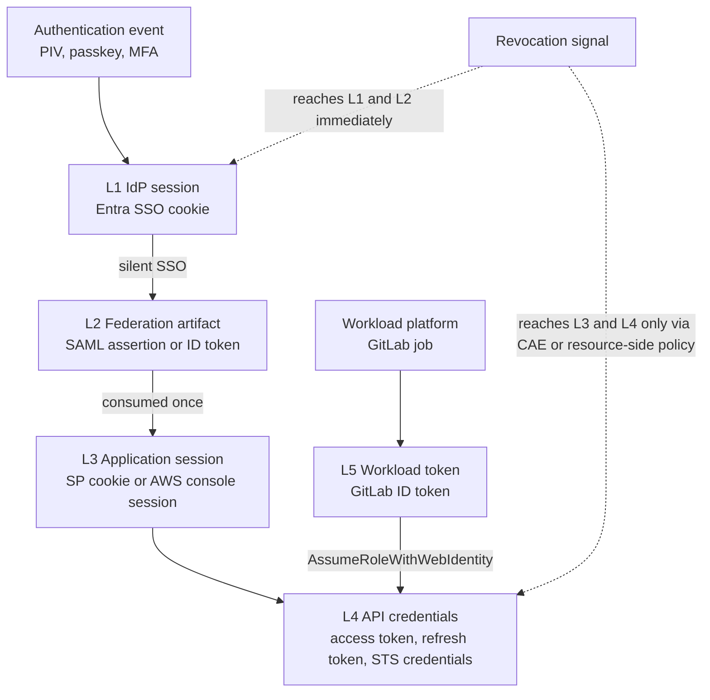
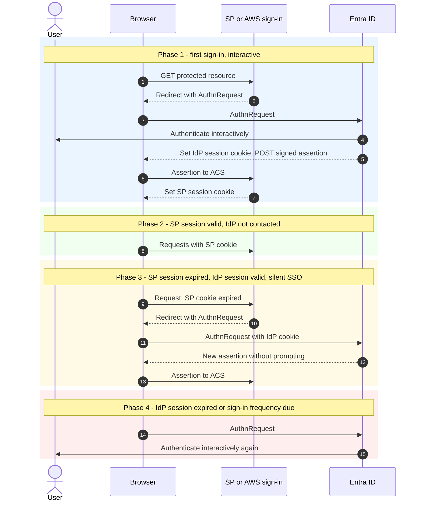
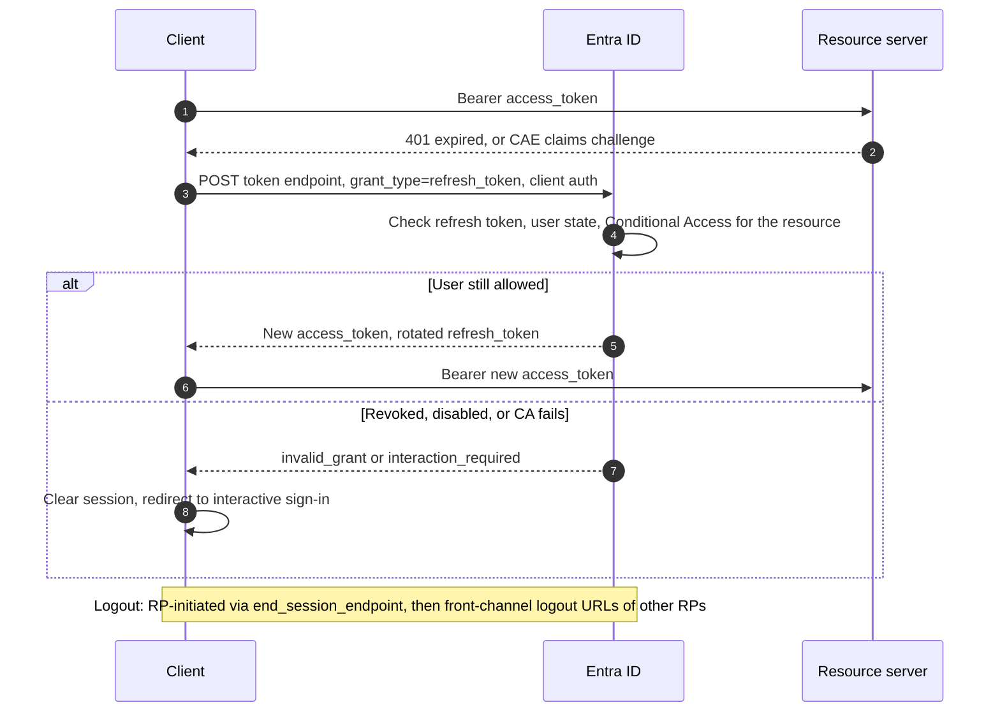

# F2 — Session & Token Lifecycle (SAML, OIDC, Entra ID, AWS)

> **Series position:** Foundations · **F2**. Read after **F1a/F1b** and **Entra Doc 2**, and before **GitLab Doc 3**. This document absorbs the planned standalone *SAML Session Lifecycle* reference.
> **Scope:** how long trust lasts after authentication, where it is cached, and how to end it — the revocation half of Zero Trust.
> **Last verified:** 2026-11-07

---

## TL;DR

1. **Authentication happens once. After that, trust is cached in up to five independent layers**, each on its own clock — the **Session Stack** (§2).
2. **A SAML assertion is a one-time delivery, not a session.** Its `NotOnOrAfter` bounds the delivery window, not how long the user stays signed in.
3. **Signing out of one layer doesn't sign the user out of the others.** AWS console sign-out leaves the Entra session alive. Disabling an Entra user doesn't end AWS STS sessions that were already issued.
4. **Revocation gap = the time between a decision changing and every cached copy expiring.** For Entra → AWS console it is roughly the `SessionDuration` you emit; the deployed policy emits 4 h.
5. **Three levers close the gap:** shorter clocks, push-based revocation (CAE), and resource-side kill switches (`AWSRevokeOlderSessions`, SCP deny).

---

## 1. Problem (HLD)

Zero Trust says "verify explicitly, continuously." Every federation protocol does the opposite on purpose. It verifies once, then hands out a bearer artifact so that the next thousand requests don't need the IdP. That is good for availability and bad for revocation. Every design in this series is a trade-off between the two, and an ATO package should state that trade-off as numbers: which layer, which clock, and the worst-case window.

---

## 2. The Session Stack (named pattern)

| Layer | Artifact | Issued by | Default lifetime | Controlled by | Ended by |
|---|---|---|---|---|---|
| **L1 · IdP session** | Entra SSO session cookie | Entra | Persistent session: 90 days inactive · non-persistent: 24 h inactive | Conditional Access sign-in frequency, persistent browser session | Sign-out, `revokeSignInSessions`, CA re-evaluation |
| **L2 · Federation artifact** | SAML assertion · ID token · auth code | Entra | SAML token 1 h (+5 min skew) · ID token 1 h · code: single use | `AccessTokenLifetime` policy (10 min – 1 day; covers access, ID, and SAML tokens) | Expiry only |
| **L3 · Application session** | SP cookie · **AWS console session** | The SP / AWS sign-in | App-defined · AWS: `SessionDuration` 900–43,200 s (default 1 h) | SP config · SAML `SessionDuration` / `SessionNotOnOrAfter` (lesser wins) | App logout · AWS: role revocation (§6) |
| **L4 · API credentials** | Access token · refresh token · **AWS STS credentials** | Entra / STS | Access 60–90 min (CAE: 24–28 h) · refresh: 90 days inactive, max age until revoked · STS: 900 s to the role max (1–12 h); chained ≤ 1 h | Token lifetime policy · CA · role `MaxSessionDuration` · `DurationSeconds` | CAE events · refresh revocation · `AWSRevokeOlderSessions` |
| **L5 · Workload token** | GitLab ID token | GitLab | ≈ job timeout (default 60 min) plus a short leeway | Job `timeout:` | Expiry only (or remove the signing key from the JWKS — GitLab Doc 3 RB-7) |



**Key insight:** revocation flows *down* the stack only as far as each layer re-checks upstream. AWS never calls Entra again after `AssumeRoleWithSAML`, so an Entra-side revocation cannot reach L3 or L4 at AWS.

---

## 3. SAML session lifecycle

### 3.1 Authentication vs session — the four phases



**What this explains:** a user who signs out of the AWS console and clicks the AWS tile again goes straight back in (Phase 3). That isn't a bug. The IdP session (L1) is still valid.

### 3.2 SAML timing elements — what each one controls

| Element | Location | Meaning | Enforced by |
|---|---|---|---|
| `IssueInstant` | Response, Assertion | When it was issued | SP (clock-skew window) |
| `Conditions/@NotBefore`, `@NotOnOrAfter` | Assertion | Validity window of the assertion. Entra default: 1 h + 5 min skew, adjustable via `AccessTokenLifetime` | SP |
| `SubjectConfirmationData/@NotOnOrAfter` | Subject | How long the bearer may *present* it. Short; **not** affected by Entra token-lifetime policy | SP |
| `AuthnStatement/@AuthnInstant` | Assertion | When the user actually authenticated, which can be hours before issuance in Phase 3 | SP, if it checks authentication age |
| `AuthnStatement/@SessionNotOnOrAfter` | Assertion (optional) | IdP's suggested maximum SP session | SP (AWS: the lesser of this and `SessionDuration`) |
| `AuthnStatement/@SessionIndex` | Assertion | Session identifier used by Single Logout | SP + IdP |

### 3.3 Forcing re-authentication

| Mechanism | Side | Effect | Caveat |
|---|---|---|---|
| `ForceAuthn="true"` in the AuthnRequest | SP | IdP must re-authenticate even if an IdP session exists | SP-initiated only; AWS console sign-in doesn't expose this |
| `IsPassive="true"` | SP | IdP must *not* prompt; fails if there is no session | Used for silent checks |
| Conditional Access **sign-in frequency** | IdP | Forces Phase 4 on a schedule, per app | The Zero Trust control for privileged apps |
| Check `AuthnInstant` age | SP | Reject stale authentication | Most SPs don't, including AWS |

### 3.4 Single Logout — the reality

- SAML SLO is front-channel: a browser redirect chain through every SP holding a `SessionIndex`. If one SP is down or a browser tab closes, the chain stops partway.
- Entra supports a SAML Logout URL per enterprise app.
- **AWS IAM SAML federation documents no SLO endpoint.** Treat AWS console sign-out as local to L3. It ends neither the Entra session nor any STS credentials the user already exported.
- **Logout is a user convenience; revocation is a security control.** Never cite SLO as a revocation control in an ATO.

---

## 4. OIDC lifecycle

### 4.1 Token clocks (Entra)

| Token | Default | Configurable | Revocation |
|---|---|---|---|
| ID token | 1 h | `AccessTokenLifetime` policy | None; valid until expiry |
| Access token | Random 60–90 min (avg 75) | `AccessTokenLifetime` (10 min – 1 day) | CAE-capable resources: near-real-time. Others: none until expiry |
| Access token, CAE session | 24–28 h | — | Critical events revoked in near real time |
| Refresh token | 90 days max inactive · max age until revoked | **No.** Not configurable since 2021-01-30; use CA sign-in frequency | `revokeSignInSessions`, password change, admin action |
| Session token (cookie) | Persistent 90 days / non-persistent 24 h inactive | **No.** Use CA | Same as refresh token |

**Precedence:** an organization-level token lifetime policy overrides an application-level one.

### 4.2 Refresh and logout



| Logout spec (OpenID, final) | Mechanism | Reliability |
|---|---|---|
| RP-Initiated Logout 1.0 | RP redirects the browser to the OP `end_session_endpoint` | Ends the OP session (L1) |
| Front-Channel Logout 1.0 | OP loads each RP's logout URL in hidden iframes | Fragile; third-party cookie restrictions break it |
| Back-Channel Logout 1.0 | OP POSTs a signed logout token to each RP server-to-server | Most reliable. **Check current Entra docs before assuming support.** Entra app registrations expose a front-channel logout URL |

**Refresh token binding:** confidential clients bind refresh tokens through client authentication. Public clients need rotation or sender-constraint (RFC 9700). A stolen refresh token from a public client is the longest-lived bearer artifact in the stack.

---

## 5. Entra ID controls — reference

| Control | Layer | What it changes | Notes |
|---|---|---|---|
| Token lifetime policy (`AccessTokenLifetime`) | L2, L4 | Access, ID, and SAML token lifetime, 10 min – 1 day | Doesn't change `SubjectConfirmationData` `NotOnOrAfter` |
| CA sign-in frequency | L1 | How often a user must re-authenticate interactively | The replacement for retired refresh/session lifetime settings |
| CA persistent browser session | L1 | Whether the SSO cookie survives a browser restart | Set to "never persistent" for privileged access |
| CA authentication strength | L1 | Requires phishing-resistant methods | Pair with RP-side `acr`/`amr` checks (F1a §5.3) |
| Continuous Access Evaluation | L4 | Near-real-time revocation for CAE-capable clients and resources | Applies to Entra-issued tokens at supporting resources. **AWS is not a CAE resource** |
| `POST /users/{id}/revokeSignInSessions` | L1, L4 refresh | Invalidates refresh tokens and session cookies | Issued access tokens remain valid until expiry unless the resource supports CAE |
| Disable account / remove assignment | L1, L2 | No new tokens or assertions | Does nothing to sessions already established at SPs (L3/L4) |

---

## 6. AWS controls — reference

### 6.1 Session durations

| Path | Duration source | Range | Notes |
|---|---|---|---|
| Console via SAML | `SessionDuration` attribute | 900–43,200 s; default 1 h | The lesser of `SessionDuration` and `SessionNotOnOrAfter` wins. AWS doesn't document the interaction with role `MaxSessionDuration` for console sign-in, so set `MaxSessionDuration` ≥ `SessionDuration` and test |
| CLI `AssumeRoleWithSAML` | `DurationSeconds` | 900 s – role max (1–12 h); default 3600 | Exceeding the role max fails |
| `AssumeRoleWithWebIdentity` (GitLab) | `DurationSeconds` | 900 s – role max; default 3600 | The GitLab LLD uses 3600 |
| Role chaining (`AssumeRole` from a role session) | `DurationSeconds` | **≤ 1 h** | Values > 1 h fail |

### 6.2 Revocation levers

| Lever | Scope | Affects existing sessions? | Mechanism |
|---|---|---|---|
| **Revoke active sessions** (console) | Every session of one role issued before T + ~30 s | **Yes** | Inline policy `AWSRevokeOlderSessions`: Deny `*` if `aws:TokenIssueTime` < T. Requires `iam:PutRolePolicy` |
| Manual `aws:TokenIssueTime` deny | Same, with a chosen T | Yes | Same policy, any timestamp |
| Targeted deny by session | One user's sessions on that role | Yes | Deny with `aws:userid` = `<RoleId>:<RoleSessionName>`, or `aws:SourceIdentity` = the user's ID. Blocks *future* sessions too until removed |
| SCP deny on role ARN pattern | All member accounts | Yes | `aws:PrincipalArn` ArnLike `role/<pattern>`. Doesn't apply to the management account |
| Edit trust policy / remove provider | One role / one account | **No.** New exchanges only | Pair with a revoke (GitLab Doc 3, Two-lever rule) |

```json
{
  "Version": "2012-10-17",
  "Statement": [
    {
      "Sid": "DenyOneCompromisedUserOnThisRole",
      "Effect": "Deny",
      "Action": "*",
      "Resource": "*",
      "Condition": { "StringLike": { "aws:userid": "AROAEXAMPLEROLEID:jane.doe@agency.mil" } }
    }
  ]
}
```

> **Why the targeted deny works:** for an assumed-role session, `aws:userid` is `<role unique ID>:<RoleSessionName>`. This is one more reason RoleSessionName must be unique per human (Entra Doc 2 §5.2). With SourceIdentity configured, `aws:SourceIdentity` also catches the user's chained sessions.

---

## 7. The Revocation Matrix

Worst-case window **W = the longest remaining lifetime of any cached artifact downstream of the revoked decision.**

| Event | Entra L1/L2 | OIDC web app (L3/L4) | AWS console via SAML (L3/L4) | GitLab → AWS (L4/L5) | Action to close the gap |
|---|---|---|---|---|---|
| **User disabled in Entra** | Immediate: no new assertions or tokens | Refresh fails; access token valid ≤ 60–90 min (CAE resources: near real time) | **Session valid until `SessionDuration` expiry** (deployed: ≤ 4 h) | n/a | AWS: targeted deny or revoke role sessions · App: kill the app session |
| **Removed from app role / assignment** | New assertions lack Role, or are refused | Existing tokens keep old `roles` until expiry | Existing session continues | n/a | Same as above |
| **Password reset / `revokeSignInSessions`** | Refresh tokens and cookies invalid | Same as disable | Session continues | n/a | Same as above |
| **Device non-compliant / risky location** | CA blocks the next issuance | CAE resources may revoke; others keep tokens to expiry | **No signal reaches AWS** | n/a | Network conditions on roles (`aws:SourceVpce`, `aws:SourceIp`) |
| **Stolen AWS session credentials** | Irrelevant | n/a | Valid until expiry | Valid until expiry | `AWSRevokeOlderSessions` + investigate (GitLab Doc 3 IR-1) |
| **Compromised GitLab project or runner** | n/a | n/a | n/a | New exchanges continue until trust is edited; existing STS sessions continue | GitLab Doc 3 kill-switch ladder |

```mermaid
gantt
    title Revocation gap - user signs in at 08:50, account disabled at 09:00
    dateFormat HH:mm
    axisFormat %H:%M
    section Entra
    Account disabled, no new tokens :milestone, m1, 09:00, 0m
    section OIDC web app
    Access token still valid, no CAE :active, o1, 08:50, 75m
    section AWS console via SAML
    STS session still valid, SessionDuration 4h :crit, a1, 08:50, 240m
    section AWS revoke
    Revoke active sessions, gap closed :milestone, m2, 09:05, 0m
```



---

## 8. Zero Trust tuning — starting points

These are starting points to adjust through your ATO risk acceptance, not mandates.

| Tier | Examples | AWS `SessionDuration` / `DurationSeconds` | Entra controls | AWS-side controls |
|---|---|---|---|---|
| **Privileged / production write** | Prod deploy roles, admin consoles | ≤ 1 h | Sign-in frequency short; authentication strength = phishing-resistant; never-persistent browser session | Network-bound conditions; named role pattern for SCP kill switch; SourceIdentity |
| **Standard operational** | Read/write in non-prod | 1–4 h | Sign-in frequency per policy | SourceIdentity; revoke runbook rehearsed |
| **Read-only** | View-only roles | ≤ 4 h (document the gap) | Standard CA | Monitoring |
| **Workload (GitLab)** | Deploy jobs | `DurationSeconds` ≈ job duration; job `timeout:` tight | n/a | Trust pinned to `sub` + `aud`; network conditions; GitLab Doc 3 |

---

## 9. Signing-key and certificate lifecycle

| Key | Owner | Rotation behavior | Failure mode | Practice |
|---|---|---|---|---|
| Entra SAML signing certificate (per enterprise app) | Entra | Admin-initiated rollover before expiry | AWS: "Response signature invalid". **IAM doesn't check certificate expiration**, so a stale provider fails only at cutover | Track expiry externally. Update the IAM SAML provider metadata (`update-saml-provider`) in the same change window as activation |
| Entra OIDC token signing keys | Entra | Rotated automatically; published via JWKS | Clients that pin a key break | Resolve by `kid` from JWKS; never pin |
| AWS SAML assertion-encryption private keys | You (uploaded to the IAM SAML provider) | **Maximum 2 keys per provider** | "Private key limit of 2 is reached" | Add the new key, switch the IdP's encryption certificate, then remove the old key |
| GitLab ID token signing key (self-managed) | GitLab admin | No vendor-documented zero-downtime procedure found | STS `InvalidIdentityToken` | GitLab Doc 3 RB-7 |
| TLS chain of the OIDC issuer / JWKS host | Issuer operator | Certificate renewal | Federation breaks if AWS relies on the thumbprint fallback | GitLab Doc 3 RB-8 |

---

## 10. FAQ / troubleshooting

| Question or symptom | Answer |
|---|---|
| "I signed out of AWS but the tile signs me straight back in." | L1 Entra session still valid (§3.1 Phase 3). Expected behavior. |
| "We disabled the user, but CloudTrail shows activity for another hour." | L3/L4 AWS session outlives the Entra decision (§7). Revoke on the AWS side. |
| "SAML token lifetime set to 10 min but users stay in AWS for hours." | Token lifetime governs the *assertion* (L2), not the AWS session (L3). Change `SessionDuration`. |
| "Sign-in fails after raising SessionDuration to 8 h." | Check the role `MaxSessionDuration` (§6.1). |
| "Refresh token lifetime policy has no effect." | Retired 2021-01-30. Use CA sign-in frequency. |
| "CAE will protect AWS." | No. CAE applies to Entra-issued tokens at CAE-capable resources. AWS consumes the assertion once. |
| "SLO will kill AWS sessions." | No. AWS documents no SLO endpoint, and SLO isn't revocation (§3.4). |

---

## 11. References

1. Microsoft Entra — Configurable token lifetimes (defaults, `AccessTokenLifetime`, retired refresh/session settings, CAE lifetimes). https://learn.microsoft.com/entra/identity-platform/configurable-token-lifetimes
2. Microsoft Entra — Continuous access evaluation. https://learn.microsoft.com/entra/identity/conditional-access/concept-continuous-access-evaluation
3. AWS IAM — Configure SAML assertions for the authentication response (`SessionDuration`, `SessionNotOnOrAfter`, `SourceIdentity`). https://docs.aws.amazon.com/IAM/latest/UserGuide/id_roles_providers_create_saml_assertions.html
4. AWS STS API — AssumeRoleWithSAML (`DurationSeconds`, role maximum, role chaining). https://docs.aws.amazon.com/STS/latest/APIReference/API_AssumeRoleWithSAML.html
5. AWS IAM — Revoke IAM role temporary security credentials (`AWSRevokeOlderSessions`, `aws:TokenIssueTime`). https://docs.aws.amazon.com/IAM/latest/UserGuide/id_roles_use_revoke-sessions.html
6. AWS IAM — Troubleshoot SAML federation (signature, encryption key limits, certificate expiry note). https://docs.aws.amazon.com/IAM/latest/UserGuide/troubleshoot_saml.html
7. SAML 2.0 Core (Conditions, SubjectConfirmationData, AuthnStatement). https://docs.oasis-open.org/security/saml/v2.0/saml-core-2.0-os.pdf
8. SAML 2.0 Profiles (Single Logout profile). https://docs.oasis-open.org/security/saml/v2.0/saml-profiles-2.0-os.pdf
9. OpenID Connect RP-Initiated Logout 1.0. https://openid.net/specs/openid-connect-rpinitiated-1_0.html
10. OpenID Connect Front-Channel Logout 1.0. https://openid.net/specs/openid-connect-frontchannel-1_0.html
11. OpenID Connect Back-Channel Logout 1.0. https://openid.net/specs/openid-connect-backchannel-1_0.html
12. RFC 9700 — OAuth 2.0 Security BCP (refresh token protection). https://www.rfc-editor.org/rfc/rfc9700
13. NIST SP 800-207 — Zero Trust Architecture. https://csrc.nist.gov/pubs/sp/800/207/final
14. GitLab MR !220980 — ID token expiration derived from job timeout. https://gitlab.com/gitlab-org/gitlab/-/merge_requests/220980
