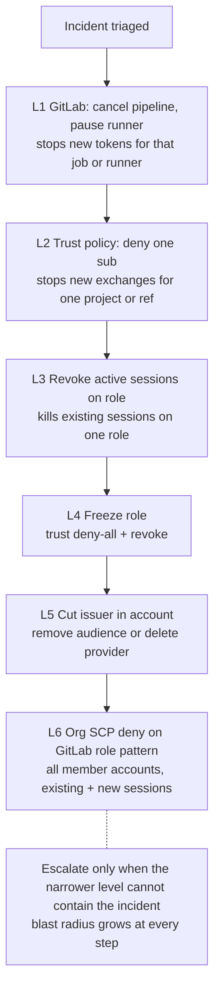
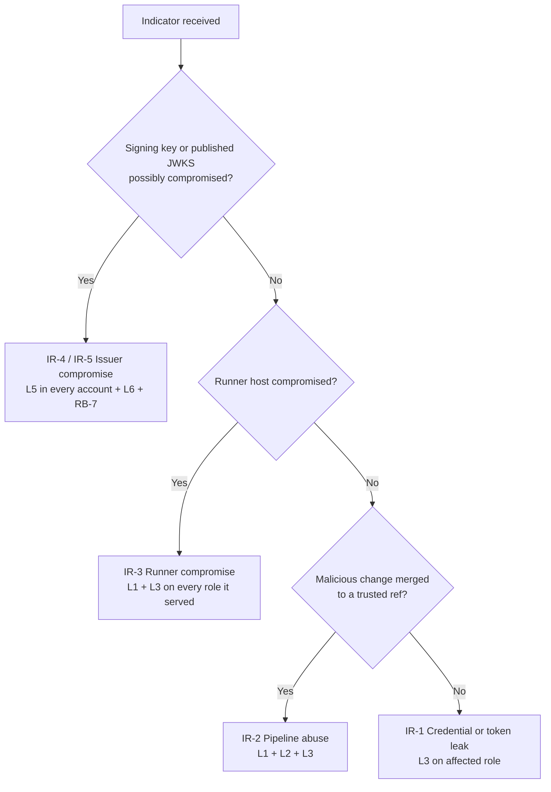

# GitLab → AWS OIDC — Doc 3: Operations Runbook (Revocation, Key Rotation, Incident Response)

> **Series position:** GitLab series · **Doc 3**. It follows the **GitLab HLD → GitLab LLD** and uses **F2** (Session Stack, revocation gap).
> **Scope:** day-2 operations — how to contain abuse, rotate trust material, and investigate GitLab → AWS federation in AWS GovCloud.
> **Placeholders:** issuer host `gitlab.example.mil` · account `123456789012` · role `GitLab-Prod-Deploy` · region `us-gov-west-1` · partition `aws-us-gov` · audience `sts.amazonaws.com`.
> **Last verified:** 2026-11-07. Steps marked **VERIFY** are version-specific; confirm them against your GitLab and AWS versions before relying on them.

---

## TL;DR

1. **Two-lever rule.** Editing trust (trust policy, OIDC provider) stops the *next* exchange. Revocation (`AWSRevokeOlderSessions`, SCP deny) stops the *current* session. An incident needs both.
2. **Use the kill-switch ladder (§2).** Start with the narrowest lever that contains the incident and escalate only as needed.
3. **The GitLab signing key is the root of trust** for every role that trusts the issuer. Compromise of that key is a P1 across all accounts (IR-4).
4. **Emergency edits get reverted by Terraform.** Land the change in code, or freeze the pipeline that owns the trust stack, in the same change window.
5. **Rehearse quarterly in non-prod (§8).** A runbook that has never been executed is a hypothesis.

---

## 1. Lifecycle facts that drive every procedure

| Fact | Value | Operational meaning |
|---|---|---|
| GitLab ID token lifetime | ≈ job timeout (project default 60 min) plus a short leeway | A leaked token can be exchanged until it expires. Tight job `timeout:` values shrink this |
| STS credential lifetime | `DurationSeconds` (the LLD uses 3600), up to the role `MaxSessionDuration` | Survives every trust edit until it expires or is revoked |
| Role chaining (central entry role → target) | ≤ 1 h | Revoke **both** the entry role and the target role |
| Trust policy / provider change | Affects new `AssumeRoleWithWebIdentity` calls only | Not containment on its own |
| `AWSRevokeOlderSessions` | Denies sessions issued before T + ~30 s | Containment for one role |
| SCP deny | Applies to existing and new sessions in member accounts | Org-wide containment; doesn't apply to the management account |
| OIDC provider ARN | Derived from the issuer URL | Recreating the provider with the same URL restores the same ARN, so trust policies resume |

---

## 2. The kill-switch ladder



| Level | Lever | Stops new exchanges | Stops existing sessions | Blast radius | Reversible | Owner | Procedure |
|---|---|---|---|---|---|---|---|
| L1 | Cancel pipeline / pause runner | That job/runner | No | One project or runner | Yes | GitLab admin / project maintainer | RB-6 |
| L2 | Trust-policy Deny on `sub` | One subject | No | One project/ref on one role | Yes | Cloud platform | RB-2 |
| L3 | Revoke active sessions | No | **Yes**, one role | All users of that role | Leave in place (harmless) | Cloud platform | RB-1 |
| L4 | Freeze role | Yes, one role | Yes, with L3 | One role | Yes | Cloud platform | RB-3 |
| L5 | Cut issuer in an account | Yes, every role trusting the issuer in that account | No | One account | Yes (same ARN) | Cloud platform | RB-4 |
| L6 | SCP deny on role pattern | Effectively yes | **Yes** | Every member account | Yes (detach) | Org admin / security | RB-5 |

> **Not a control:** deleting or changing the `AWS_ROLE_ARN` CI variable. A role ARN isn't a secret, and an attacker with pipeline-edit rights can hardcode it. The trust policy is the control.

---

## 3. Procedures

All commands assume an administrative GovCloud session, `AWS_REGION=us-gov-west-1`, and the AWS CLI v2.

### RB-1 · Revoke active sessions for a role (L3)

**Use when:** credentials from a role may be in the wrong hands (leaked logs, artifacts, a runner compromise).

```bash
ROLE=GitLab-Prod-Deploy
T=$(date -u -d '+60 seconds' +%Y-%m-%dT%H:%M:%SZ)   # GNU date; macOS: date -u -v+60S +%Y-%m-%dT%H:%M:%SZ
                                                     # small future buffer covers propagation (console uses ~30 s)

cat > revoke.json <<EOF
{
  "Version": "2012-10-17",
  "Statement": [{
    "Effect": "Deny",
    "Action": "*",
    "Resource": "*",
    "Condition": { "DateLessThan": { "aws:TokenIssueTime": "$T" } }
  }]
}
EOF

aws iam put-role-policy --role-name "$ROLE" \
  --policy-name AWSRevokeOlderSessions --policy-document file://revoke.json
```

| Step | Check |
|---|---|
| Verify | `aws iam get-role-policy --role-name "$ROLE" --policy-name AWSRevokeOlderSessions` · CloudTrail shows `AccessDenied` for the old session's `accessKeyId` |
| Chained roles | Repeat on the central entry role **and** every target role reached from it |
| Rollback | Usually unnecessary. Once `MaxSessionDuration` has passed after T, the policy denies nothing that still exists. Remove it with `aws iam delete-role-policy` when convenient |
| Side effect | Running legitimate deploy jobs on that role fail mid-apply. Expect Terraform state locks to need clearing |

### RB-2 · Block one project or ref (L2)

**Use when:** a single project or branch is suspect and the rest of the fleet should keep deploying.

```bash
aws iam get-role --role-name "$ROLE" \
  --query 'Role.AssumeRolePolicyDocument' > trust.current.json
# Add the Deny statement below to Statement[], save as trust.new.json
aws iam update-assume-role-policy --role-name "$ROLE" --policy-document file://trust.new.json
```

```json
{
  "Sid": "EmergencyDenySuspectProject",
  "Effect": "Deny",
  "Principal": { "Federated": "arn:aws-us-gov:iam::123456789012:oidc-provider/gitlab.example.mil" },
  "Action": "sts:AssumeRoleWithWebIdentity",
  "Condition": { "StringLike": { "gitlab.example.mil:sub": "project_path:platform/aws-infra:*" } }
}
```

| Step | Check |
|---|---|
| Verify | A test job from the denied project gets `AccessDenied`; other projects still succeed |
| Pair with | RB-1 if sessions may already be issued |
| **Terraform drift** | The next `apply` of the trust stack removes this statement. Commit the Deny to code, or freeze that pipeline, in the same change |
| Self-managed note | Only `sub` and `aud` are available as condition keys (LLD §4), so match on the `sub` string, not on `project_id` |

### RB-3 · Freeze a role (L4)

Replace the trust policy with a deny-all for the federated principal, then run RB-1.

```json
{
  "Version": "2012-10-17",
  "Statement": [{
    "Sid": "EmergencyFreeze",
    "Effect": "Deny",
    "Principal": { "Federated": "arn:aws-us-gov:iam::123456789012:oidc-provider/gitlab.example.mil" },
    "Action": "sts:AssumeRoleWithWebIdentity"
  }]
}
```

Keep a copy of `trust.current.json` as evidence and for restore.

### RB-4 · Cut the issuer in one account (L5)

| Option | Command | Effect | Restore |
|---|---|---|---|
| **A · Remove the audience** (narrower) | `aws iam remove-client-id-from-open-id-connect-provider --open-id-connect-provider-arn arn:aws-us-gov:iam::123456789012:oidc-provider/gitlab.example.mil --client-id sts.amazonaws.com` | Every role in the account using this provider and audience fails new exchanges | `aws iam add-client-id-to-open-id-connect-provider … --client-id sts.amazonaws.com` |
| **B · Delete the provider** | `aws iam delete-open-id-connect-provider --open-id-connect-provider-arn arn:aws-us-gov:iam::123456789012:oidc-provider/gitlab.example.mil` | All roles fail: "No OpenIDConnect provider found" | `create-open-id-connect-provider` with the same URL, audience, and thumbprint(s) → same ARN, so trust policies resume |

Neither option touches existing sessions. Pair them with RB-1 or RB-5.

### RB-5 · Org-wide containment with an SCP (L6)

**Prerequisite (do this now, not during the incident):** every GitLab-federated role follows a naming convention such as `GitLab-*`. Without one, no single SCP can target them.

```json
{
  "Version": "2012-10-17",
  "Statement": [{
    "Sid": "EmergencyDenyGitLabFederatedRoles",
    "Effect": "Deny",
    "Action": "*",
    "Resource": "*",
    "Condition": { "ArnLike": { "aws:PrincipalArn": "arn:aws-us-gov:iam::*:role/GitLab-*" } }
  }]
}
```

```bash
POLICY_ID=$(aws organizations create-policy --type SERVICE_CONTROL_POLICY \
  --name EmergencyDenyGitLab --description "IR containment" \
  --content file://scp.json --query 'Policy.PolicySummary.Id' --output text)
aws organizations attach-policy --policy-id "$POLICY_ID" --target-id <root-or-ou-id>
```

| Note | Detail |
|---|---|
| GovCloud | GovCloud accounts belong to their own GovCloud organization. Run this from the GovCloud management account |
| Management account | SCPs don't apply to it. Keep no GitLab-federated roles there |
| Restore | `aws organizations detach-policy`; existing sessions resume if they haven't expired |

### RB-6 · GitLab-side containment (L1)

GitLab REST API v4. **VERIFY** endpoint details for your GitLab version.

```bash
GL=https://gitlab.example.mil/api/v4
H="PRIVATE-TOKEN: $GITLAB_ADMIN_TOKEN"

curl -sf -X POST -H "$H" "$GL/projects/$PROJECT_ID/pipelines/$PIPELINE_ID/cancel"   # cancel pipeline
curl -sf -X PUT  -H "$H" "$GL/runners/$RUNNER_ID" --data "paused=true"              # pause runner
curl -sf -X POST -H "$H" "$GL/users/$USER_ID/block"                                 # block user (admin)
```

Also: protect or lock the affected branch, require approvals on the protected environment, and revoke the user's personal, project, and group access tokens.

### RB-7 · Rotate the GitLab ID-token signing key (self-managed)

**Facts.** On self-managed GitLab the key is the `ci_jwt_signing_key` application setting (stored in the database, not in `gitlab.rb`). The issuer's JWKS publishes it, and AWS selects keys by the token header `kid`. **As of 2026-11-07, no vendor-documented zero-downtime dual-key procedure was found, so plan this as a cutover.**

**What rotation does.** Once the old key leaves the JWKS, every token signed with it fails at STS (`InvalidIdentityToken`). That makes rotation a revocation of all outstanding GitLab ID tokens. **Existing STS sessions are unaffected**, so add RB-1 if they matter.

| # | Step | Detail |
|---|---|---|
| 1 | Change request + window | Expect in-flight deploy jobs to fail |
| 2 | Drain | Pause deploy runners (RB-6); wait for running jobs to finish |
| 3 | Rotate | Follow GitLab Support guidance for your exact version. **VERIFY** |
| 4 | Confirm publication | `curl -s https://gitlab.example.mil/.well-known/openid-configuration` → follow `jwks_uri` → the new `kid` is present and the old one is absent |
| 5 | Private GitLab with published metadata (HLD §9, LLD §12) | Republish discovery + JWKS to the public location. **The published JWKS is now the root of trust**, so protect writes to it |
| 6 | Canary | Run one non-prod deploy job; expect a successful `AssumeRoleWithWebIdentity` |
| 7 | Resume | Unpause runners; watch failure rates (§5.3 D1) |
| Fail | `InvalidIdentityToken` persists | The JWKS isn't updated, or the published copy is stale. AWS may cache JWKS briefly, so retry the canary after a short wait |

### RB-8 · TLS chain and thumbprint maintenance

**Why it matters in DoD environments.** AWS validates the issuer's discovery/JWKS TLS certificate against its trusted root-CA library, and uses the provider's **thumbprint list** as a fallback (LLD §3). A GitLab host with a DoD PKI certificate may be outside that library. In that case the thumbprint is load-bearing, and a certificate renewal under a different intermediate breaks federation. Assume the thumbprint is in use until a test proves otherwise.

```bash
HOST=gitlab.example.mil
# Keep only the LAST certificate in the served chain (per AWS thumbprint guidance)
openssl s_client -servername "$HOST" -showcerts -connect "$HOST:443" </dev/null 2>/dev/null \
  | awk '/-----BEGIN CERTIFICATE-----/{buf=""} {buf=buf $0 "\n"} /-----END CERTIFICATE-----/{last=buf} END{printf "%s", last}' \
  > last-in-chain.pem
openssl x509 -in last-in-chain.pem -fingerprint -sha1 -noout | sed 's/.*=//; s/://g'

aws iam update-open-id-connect-provider-thumbprint \
  --open-id-connect-provider-arn arn:aws-us-gov:iam::123456789012:oidc-provider/$HOST \
  --thumbprint-list <NEW_THUMBPRINT> <OLD_THUMBPRINT>      # up to 5; add new BEFORE cutover
```

After the cutover and a successful canary, remove the old thumbprint. If the metadata is published on an AWS-hosted endpoint (S3/CloudFront with an Amazon-trusted certificate), the thumbprint usually isn't load-bearing, but verify that rather than assume it.

---

## 4. Incident response playbooks



| Playbook | Indicators | Severity | Contain | Investigate | Eradicate / recover | Preserve |
|---|---|---|---|---|---|---|
| **IR-1 · Token or STS credential leak** (job log, artifact, cache) | Secret scanner hit; credentials used from a non-runner IP (§5.3 D3) | P2 (P1 for prod roles) | RB-1 on the role | §5.2 Q1, Q3: every use of that `accessKeyId` | Fix masking; purge logs and artifacts; tighten `DurationSeconds` | CloudTrail, job log copy, artifact hashes |
| **IR-2 · Pipeline abuse** (malicious MR merged, compromised maintainer) | Unexpected deploy; IaC drift; unusual role session names | P1 | RB-6 (cancel, block user) → RB-2 → RB-1 | Pipeline → commit → approver chain; §5.2 Q4 | Revert commit; rotate the user's tokens; review CODEOWNERS and approval rules | Pipeline URL, commit SHA, MR approvals, plan artifacts |
| **IR-3 · Runner compromise** | EDR alert on a runner; unexpected egress | P1 | RB-6 (pause runner) → RB-1 on **every role the runner served** | Which jobs ran on the runner since the compromise window; §5.2 Q3 | Rebuild runners from image; rotate runner registration | Runner disk and memory image, job history |
| **IR-4 · GitLab signing-key compromise** | Key material exposure; tokens for projects that never ran; valid signatures on unknown `jti` | **P1, org-wide** | RB-4 in **every account** trusting the issuer + RB-5 + RB-1 on high-impact roles | All `AssumeRoleWithWebIdentity` calls since the exposure window, by `sub` (§5.2 Q1) | RB-7 rotation; restore RB-4 only after the canary passes | Key-access logs, GitLab admin audit events |
| **IR-5 · Published metadata tampering** (private-GitLab workaround) | Unexpected writes to the metadata bucket; a JWKS `kid` you didn't issue | **P1, org-wide** | Same as IR-4; restore known-good metadata from versioning | Bucket access logs, CloudTrail data events | Lock down write path; object lock / versioning alerts | Object versions, access logs |

---

## 5. Detection and investigation

### 5.1 CloudTrail fields that matter

| Event | Field | Use |
|---|---|---|
| `AssumeRoleWithWebIdentity` | `userIdentity.type` = `WebIdentityUser`, `userIdentity.identityProvider` | Confirms a GitLab-federated exchange |
| | `requestParameters.roleArn`, `.roleSessionName`, `.durationSeconds` | Which role, which pipeline (LLD session-name convention), how long |
| | `responseElements.subjectFromWebIdentityToken`, `.audience`, `.provider` | GitLab `sub` and `aud` as AWS accepted them |
| | `responseElements.assumedRoleUser.arn`, `.credentials.accessKeyId` | Pivot keys into all subsequent API calls |
| | `errorCode` (`AccessDenied`, `InvalidIdentityToken`), `sourceIPAddress` | Failures and origin of the exchange |
| Subsequent calls | `userIdentity.type` = `AssumedRole`, `.arn`, `.accessKeyId`, `.sessionContext.sessionIssuer.arn`, `.sessionContext.attributes.creationDate` | Everything the session did |
| Trust-plane changes | `UpdateAssumeRolePolicy`, `PutRolePolicy`, `CreateOpenIDConnectProvider`, `DeleteOpenIDConnectProvider`, `AddClientIDToOpenIDConnectProvider`, `RemoveClientIDFromOpenIDConnectProvider`, `UpdateOpenIDConnectProviderThumbprint` | Who changed trust, and when |

STS events are recorded in the region of the STS endpoint called (regional STS in GovCloud). Make sure the organization trail covers both GovCloud regions.

### 5.2 Splunk queries

Field names assume the Splunk Add-on for AWS `aws:cloudtrail` sourcetype with JSON field extraction. Adjust the index name and paths to your ingestion.

**Q1 — Exchanges by GitLab subject and role**

```spl
index=aws sourcetype=aws:cloudtrail eventName=AssumeRoleWithWebIdentity
| stats count min(_time) as first max(_time) as last values(sourceIPAddress) as src_ips values(errorCode) as errors
    by responseElements.subjectFromWebIdentityToken requestParameters.roleArn
| convert ctime(first) ctime(last)
```

**Q2 — Federation failures (a spike means misconfiguration or probing)**

```spl
index=aws sourcetype=aws:cloudtrail eventName=AssumeRoleWithWebIdentity errorCode=*
| timechart span=15m count by errorCode
```

**Q3 — GitLab role sessions used from outside known runner egress**

```spl
index=aws sourcetype=aws:cloudtrail userIdentity.type=AssumedRole
    userIdentity.arn="arn:aws-us-gov:sts::*:assumed-role/GitLab-*"
    NOT sourceIPAddress IN ("203.0.113.10", "203.0.113.11")
    NOT sourceIPAddress="*.amazonaws.com"
| stats count values(eventName) as actions by userIdentity.arn userIdentity.accessKeyId sourceIPAddress
```

**Q4 — Map role sessions back to GitLab pipelines (LLD session name `gitlab-<project>-<pipeline>`)**

```spl
index=aws sourcetype=aws:cloudtrail eventName=AssumeRoleWithWebIdentity
| rex field=requestParameters.roleSessionName "^gitlab-(?<project_id>\d+)-(?<pipeline_id>\d+)$"
| table _time project_id pipeline_id requestParameters.roleArn responseElements.subjectFromWebIdentityToken sourceIPAddress
```

**Q5 — Trust-plane changes**

```spl
index=aws sourcetype=aws:cloudtrail eventSource=iam.amazonaws.com
    eventName IN (UpdateAssumeRolePolicy, PutRolePolicy, DeleteRolePolicy, CreateOpenIDConnectProvider,
                  DeleteOpenIDConnectProvider, AddClientIDToOpenIDConnectProvider,
                  RemoveClientIDFromOpenIDConnectProvider, UpdateOpenIDConnectProviderThumbprint)
| table _time userIdentity.arn eventName requestParameters.roleName requestParameters.openIDConnectProviderArn sourceIPAddress
```

> Q3 caveats: calls through VPC endpoints show private IPs, and calls made by AWS services on your behalf show a service name. Add both to the allowlist logic deliberately rather than broadly.

### 5.3 Detection rules

| ID | Rule | Signal | Response |
|---|---|---|---|
| D1 | Federation failure spike | Q2 above baseline | Check recent trust/provider changes (Q5); possible probing |
| D2 | Unknown subject | `subjectFromWebIdentityToken` not in the approved project/ref list | IR-2 triage |
| D3 | **Off-runner credential use** | Q3 returns rows | **IR-1.** Highest-fidelity leak indicator |
| D4 | Trust-plane change outside change window | Q5 by non-pipeline principal | Validate against change record; possible persistence |
| D5 | Duration anomaly | `durationSeconds` > the approved value | Pipeline config drift or attacker tooling |
| D6 | Exchange outside deploy hours (prod) | Q1 by time | Confirm with the release owner |

---

## 6. Preventive controls that shrink blast radius

| Control | Effect on incidents | Implementation |
|---|---|---|
| **Network-bound sessions** | Stolen credentials don't work off-network, which turns IR-1 into a non-event | Role permission policy Deny with `aws:SourceVpce` / `aws:SourceIp`. Exempt `aws:ViaAWSService` (snippet below) |
| Short `DurationSeconds` + tight job `timeout:` | Smaller F2 revocation gap | Match job length; never default to the role max |
| Role naming convention (`GitLab-*`) | Makes RB-5 possible | Enforce in the account factory / StackSets |
| Exact `sub` pinning | Narrows who can mint usable tokens | LLD §6.3 rules |
| Separate trust-stack ownership | Prevents an abused pipeline from editing its own trust | HLD §5 bootstrap boundary |
| Plan/apply role split | Containment of read-only abuse | LLD §16 |

```json
{
  "Sid": "DenyOutsideRunnerNetwork",
  "Effect": "Deny",
  "Action": "*",
  "Resource": "*",
  "Condition": {
    "StringNotEqualsIfExists": { "aws:SourceVpce": ["vpce-0123456789abcdef0"] },
    "BoolIfExists": { "aws:ViaAWSService": "false" }
  }
}
```

> Only use this when every AWS API that Terraform calls is reached through VPC endpoints. Otherwise, use `aws:SourceIp` with the runner NAT egress addresses instead. `aws:SourceIp` doesn't apply to requests that arrive through VPC endpoints. Test in non-prod first, because a wrong condition takes down every deploy.

---

## 7. Restore and rollback

| After | Restore action | Validation |
|---|---|---|
| RB-1 | Optional: `aws iam delete-role-policy --role-name $ROLE --policy-name AWSRevokeOlderSessions` | New session works |
| RB-2 / RB-3 | `update-assume-role-policy` with `trust.current.json` (or reconcile from code) | Canary job |
| RB-4 A | `add-client-id-to-open-id-connect-provider` | Canary job |
| RB-4 B | `create-open-id-connect-provider` with the same URL, audience, and thumbprints | `list-open-id-connect-providers` shows the same ARN; canary job |
| RB-5 | `aws organizations detach-policy` (+ `delete-policy`) | Canary in one member account |
| RB-6 | Unpause runners; unblock user only after review | Pipeline run |
| RB-7 / RB-8 | Remove the old thumbprint/key only after the canary passes | Canary job; D1 quiet |

---

## 8. Drills and evidence (RMF)

| Drill (non-prod, quarterly) | Pass criteria | NIST SP 800-53 evidence |
|---|---|---|
| RB-1 on a test role mid-job | Job fails within ~1 min; CloudTrail shows `AccessDenied` for the old key | IR-3, IR-4 |
| RB-2 on a test project | Only the denied project fails; the Terraform reconciliation step documented | IR-4, CM-3 |
| RB-4 B delete + recreate | Same ARN; canary passes without trust-policy edits | CP-10, IR-4 |
| RB-5 SCP on a sandbox OU | Existing session denied; detach restores | IR-4, AC-2 |
| RB-7 tabletop (or a lab instance) | Steps executable; owners named; window estimated | IA-5, SC-12 |
| Detection replay (D1–D6) | Each rule fires on synthetic events | AU-6, SI-4 |

---

## 9. References

1. GitLab HLD and LLD in this series (`GitLab_AWS_OIDC_High_Level_Guide.md`, `GitLab_AWS_OIDC_Low_Level_Implementation_Guide.md`).
2. AWS IAM — Revoke IAM role temporary security credentials. https://docs.aws.amazon.com/IAM/latest/UserGuide/id_roles_use_revoke-sessions.html
3. AWS STS API — AssumeRoleWithWebIdentity. https://docs.aws.amazon.com/STS/latest/APIReference/API_AssumeRoleWithWebIdentity.html
4. AWS IAM — Create an OpenID Connect identity provider. https://docs.aws.amazon.com/IAM/latest/UserGuide/id_roles_providers_create_oidc.html
5. AWS IAM — Obtain the thumbprint for an OpenID Connect identity provider. https://docs.aws.amazon.com/IAM/latest/UserGuide/id_roles_providers_create_oidc_verify-thumbprint.html
6. AWS IAM — OIDC condition context keys. https://docs.aws.amazon.com/IAM/latest/UserGuide/reference_policies_iam-condition-keys.html
7. AWS GovCloud — IAM differences. https://docs.aws.amazon.com/govcloud-us/latest/UserGuide/govcloud-iam.html
8. GitLab — OpenID Connect authentication using ID tokens. https://docs.gitlab.com/ci/secrets/id_token_authentication/
9. GitLab — Configure OpenID Connect in AWS. https://docs.gitlab.com/ci/cloud_services/aws/
10. GitLab MR !220980 — ID token expiration derived from the job timeout. https://gitlab.com/gitlab-org/gitlab/-/merge_requests/220980
11. GitLab Forum — `ci_jwt_signing_key` is stored in application settings. https://forum.gitlab.com/t/ci-jwt-signing-key-setting-has-no-effect-in-docker-image/95206
12. NIST SP 800-53 Rev. 5 — Security and Privacy Controls (IR, IA, SC, AU, SI, CM, CP families). https://csrc.nist.gov/pubs/sp/800/53/r5/upd1/final
